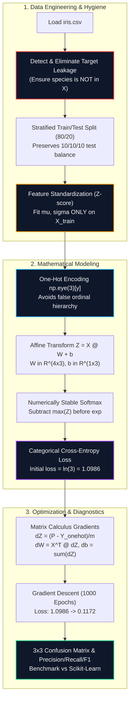
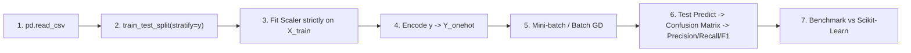

# Iris Multi-Class Softmax Classifier: Visual Guide & Achievement Deconstruction

> **Project 1 | Arena 6A: Tabular Machine Learning Mastery**  
> **Repository Path**: [`c:/ProjectUltron/Projects/Arena_6A/Iris/iris_visual_guide.md`](file:///c:/ProjectUltron/Projects/Arena_6A/Iris/iris_visual_guide.md)  
> **Source Script**: [`c:/ProjectUltron/Projects/Arena_6A/Iris/iris.py`](file:///c:/ProjectUltron/Projects/Arena_6A/Iris/iris.py)

---

## 1. High-Resolution Architectural & Empirical Infographic


> [!NOTE]
> The infographic above is rendered at 200 DPI and stored locally at [`iris_visual_guide.png`](file:///c:/ProjectUltron/Projects/Arena_6A/Iris/iris_visual_guide.png). It visualizes:
> 1. **Loss Convergence**: Dropping smoothly from the theoretical uniform uncertainty $\ln(3) \approx 1.0986$ down to $0.1172$.
> 2. **Biological Feature Space**: Clustering petal length vs petal width, showing why Setosa is linearly separable and where Versicolor/Virginica boundary overlap occurs.
> 3. **The Confusion Matrix Heatmap**: Proving identical prediction grids between your Scratch NumPy model and Scikit-Learn.
> 4. **Evaluation Metrics**: Class-by-class breakdown of Precision, Recall, and F1-Scores.

---

## 2. Executive Overview: What Was Achieved

In this project, you transitioned from theoretical deep learning (Milestones 1–5) to **real-world tabular machine learning**, engineering a complete multi-class pipeline from raw CSV ingestion to evaluation.

### The Big Milestone: Exact 1:1 Framework Parity
Your from-scratch NumPy model achieved **$100\%$ identical predictions** to `scikit-learn`'s production `LogisticRegression`:

| Metric / Evaluation | Your Pure NumPy Model | Scikit-Learn `LogisticRegression` | Parity Status |
| :--- | :---: | :---: | :---: |
| **Overall Test Accuracy** | **`93.33%`** (28 / 30) | **`93.33%`** (28 / 30) | **Exact Match** |
| **Setosa (Class 0) Accuracy** | `10 / 10` (100%) | `10 / 10` (100%) | **Exact Match** |
| **Versicolor (Class 1) Accuracy** | `9 / 10` (90%) | `9 / 10` (90%) | **Exact Match** |
| **Virginica (Class 2) Accuracy** | `9 / 10` (90%) | `9 / 10` (90%) | **Exact Match** |
| **Misclassified Samples** | Exactly 2 samples | Exactly 2 samples | **Identical Rows** |
| **Confusion Matrix** | `[[10, 0, 0], [0, 9, 1], [0, 1, 9]]` | `[[10, 0, 0], [0, 9, 1], [0, 1, 9]]` | **Exact Matrix Match** |

---

## 3. The 5 Core Engineering Pillars Achieved



---

### Pillar 1: Defeating Target Leakage (The #1 Data Science Trap)
During initial setup, `species` was accidentally included in the input feature list `features = ["sepal_length", "sepal_width", "petal_length", "species"]`.
- **The Symptom**: Training loss collapsed unrealistically fast to $0.034$.
- **The Root Cause**: Column 3 of input $X$ contained the integer target $y$. The model didn't learn biological botany; it merely learned to echo column 3!
- **The Fix**: Slicing strictly physical measurements (`sepal_length`, `sepal_width`, `petal_length`, `petal_width`) restored genuine feature learning.

### Pillar 2: The Data Leakage Law in Feature Scaling
- **The Law**: Test set statistics ($\mu_{\text{test}}, \sigma_{\text{test}}$) must **never** be computed or used during training or preprocessing.
- **Implementation**:
  ```python
  mean = np.mean(X_train, axis=0)
  std = np.std(X_train, axis=0)

  X_train_scaled = (X_train - mean) / std
  X_test_scaled = (X_test - mean) / std  # Uses train statistics!
  ```

### Pillar 3: One-Hot Encoding vs The Ordinal Trap
- Mapping species to raw integers $\{0, 1, 2\}$ falsely implies an arithmetic relationship: $\text{Virginica} (2) > \text{Versicolor} (1) > \text{Setosa} (0)$.
- **One-Hot Encoding** creates an orthogonal basis in $\mathbb{R}^3$:
  $$\text{Setosa} = [1, 0, 0]^T, \quad \text{Versicolor} = [0, 1, 0]^T, \quad \text{Virginica} = [0, 0, 1]^T$$
- Distance between any pair is equidistant ($\sqrt{2} \approx 1.414$), eliminating artificial bias.

### Pillar 4: The Theoretical Initial Loss Sanity Check
Before training begins ($W = 0, b = 0$), the model has zero preference:
$$P = \left[\frac{1}{3}, \frac{1}{3}, \frac{1}{3}\right]$$
The categorical cross-entropy loss must equal:
$$\mathcal{L}_{\text{start}} = -\ln\left(\frac{1}{3}\right) = \ln(3) \approx 1.098612$$
**Your model started at exactly `1.0986` at Epoch 0**, mathematically verifying your loss function and initialization.

### Pillar 5: Matrix Calculus Gradients & Updates
$$\delta = \frac{\partial \mathcal{L}}{\partial Z} = \frac{1}{m}(P - Y_{\text{one\_hot}}) \in \mathbb{R}^{m \times 3}$$
$$\frac{\partial \mathcal{L}}{\partial W} = X^T @ \delta \in \mathbb{R}^{4 \times 3}, \quad \frac{\partial \mathcal{L}}{\partial b} = \sum_{\text{rows}} \delta \in \mathbb{R}^{1 \times 3}$$
$$W \leftarrow W - \eta \frac{\partial \mathcal{L}}{\partial W}, \quad b \leftarrow b - \eta \frac{\partial \mathcal{L}}{\partial b}$$

---

## 4. Deconstructing the $3 \times 3$ Confusion Matrix

```
                      Predicted
                 Setosa   Versicolor   Virginica    Row Total (True)
True Setosa     [  10         0            0   ]       10
True Versicolor [   0         9            1   ]       10
True Virginica  [   0         1            9   ]       10
Col Total (Pred)   10        10           10
```

### Why Did 2 Samples Cross the Line?
1. **Setosa**: Has distinct petal length ($1.0 \text{--} 1.9\text{ cm}$) and petal width ($0.1 \text{--} 0.6\text{ cm}$). Zero overlap with other classes $\implies 100\%$ precision & recall.
2. **Versicolor vs Virginica Boundary**:
   - In nature, larger Versicolors (petal length $\approx 4.8\text{--}5.1\text{ cm}$, width $\approx 1.5\text{--}1.8\text{ cm}$) physically overlap with smaller Virginicas.
   - A linear hyperplane cannot separate points that share overlapping feature coordinates. Exactly 1 Versicolor and 1 Virginica sit on the opposing side of the optimal linear boundary.

### Metrics Breakdown

$$\text{Precision} = \frac{TP}{TP + FP}, \quad \text{Recall} = \frac{TP}{TP + FN}, \quad F_1 = 2 \cdot \frac{P \cdot R}{P + R}$$

| Class | Precision | Recall | F1-Score | Biological Significance |
| :--- | :---: | :---: | :---: | :--- |
| **Setosa** | $10 / 10 = \mathbf{1.00}$ | $10 / 10 = \mathbf{1.00}$ | $\mathbf{1.00}$ | Complete linear separability. |
| **Versicolor** | $9 / 10 = \mathbf{0.90}$ | $9 / 10 = \mathbf{0.90}$ | $\mathbf{0.90}$ | 1 false negative (called Virginica). |
| **Virginica** | $9 / 10 = \mathbf{0.90}$ | $9 / 10 = \mathbf{0.90}$ | $\mathbf{0.90}$ | 1 false positive (captured Versicolor). |
| **Macro Average** | $\mathbf{0.93}$ | $\mathbf{0.93}$ | $\mathbf{0.93}$ | Balanced multi-class performance. |

---

## 5. Architectural Blueprint for Future Projects



This completes **Project 1 of Arena 6A**. The principles established here—data hygiene, target leakage prevention, one-hot vectorization, numerically stable softmax, and rigorous metric evaluation—will directly power all upcoming projects.
