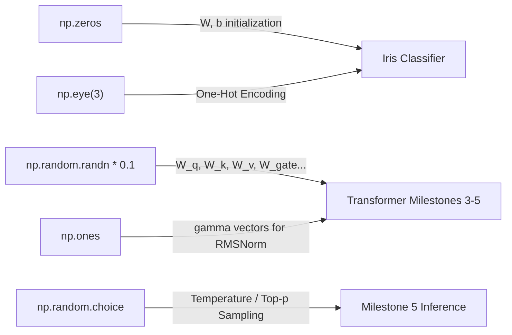
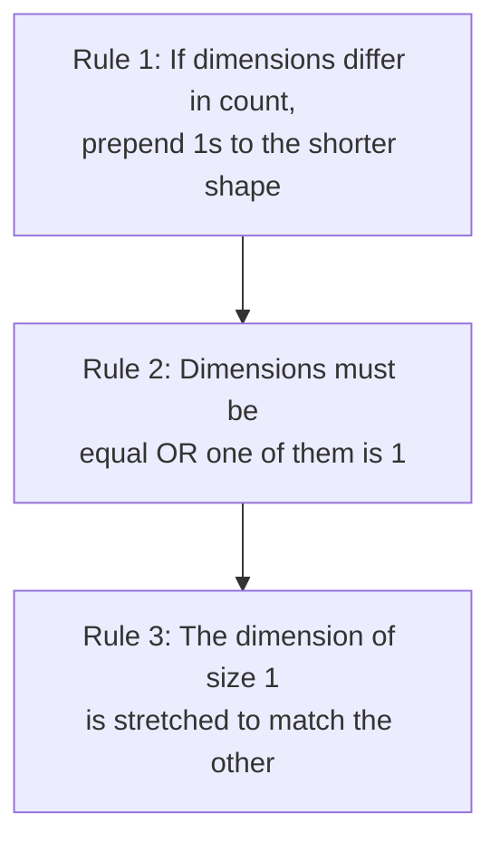

# NumPy: The Complete Reference (Beginner → Advanced)

> The foundational tensor computation library. Every matrix operation in your Milestones 1–5 runs on NumPy.

---

## 1. Array Creation

| Function | What It Does | Example | Output Shape |
| :--- | :--- | :--- | :--- |
| `np.array([1, 2, 3])` | Create array from Python list | `np.array([1, 2, 3])` | `(3,)` |
| `np.zeros((r, c))` | All-zeros matrix | `np.zeros((3, 4))` | `(3, 4)` |
| `np.ones((r, c))` | All-ones matrix | `np.ones((2, 5))` | `(2, 5)` |
| `np.eye(n)` | Identity matrix ($I_n$) | `np.eye(3)` | `(3, 3)` |
| `np.full((r, c), val)` | Fill with a constant | `np.full((2, 3), 7)` | `(2, 3)` |
| `np.arange(start, stop, step)` | Evenly spaced values | `np.arange(0, 10, 2)` | `[0, 2, 4, 6, 8]` |
| `np.linspace(start, stop, n)` | $n$ evenly spaced points | `np.linspace(0, 1, 5)` | `[0, 0.25, 0.5, 0.75, 1.0]` |
| `np.random.randn(r, c)` | Standard normal samples ($\mu=0, \sigma=1$) | `np.random.randn(4, 16)` | `(4, 16)` |
| `np.random.rand(r, c)` | Uniform $[0, 1)$ samples | `np.random.rand(3, 3)` | `(3, 3)` |
| `np.random.seed(42)` | Fix reproducibility | `np.random.seed(42)` | — |
| `np.random.choice(n, p=probs)` | Sample from distribution | `np.random.choice(11, p=probs)` | scalar |

### Where You Used These

---

## 2. Shape Manipulation

| Function | What It Does | Example |
| :--- | :--- | :--- |
| `x.shape` | Returns dimensions tuple | `(120, 4)` |
| `x.reshape(r, c)` | Reshape without copying | `x.reshape(3, -1)` (auto-infer one dim) |
| `x.T` | Transpose (swap axes) | `(4, 120)` ↔ `(120, 4)` |
| `x.flatten()` | Collapse to 1D | `(3, 4)` → `(12,)` |
| `x.squeeze()` | Remove dimensions of size 1 | `(1, 3, 1)` → `(3,)` |
| `np.expand_dims(x, axis)` | Add a dimension of size 1 | `(3,)` → `(1, 3)` or `(3, 1)` |
| `x[np.newaxis, :]` | Add leading dimension | `(4,)` → `(1, 4)` |
| `len(x)` | Length of first dimension | `len(np.zeros((120, 4)))` → `120` |

> [!TIP]
> **The `-1` Trick**: In `reshape`, passing `-1` for one dimension tells NumPy to auto-calculate it. E.g., `x.reshape(3, -1)` on a `(12,)` array gives `(3, 4)`.

---

## 3. Indexing & Slicing

| Syntax | What It Does | Example |
| :--- | :--- | :--- |
| `x[i]` | Select row $i$ | `x[0]` → first row |
| `x[i, j]` | Select element at row $i$, col $j$ | `x[2, 3]` |
| `x[start:stop]` | Slice rows | `x[1:5]` → rows 1–4 |
| `x[:, j]` | Select column $j$ (all rows) | `x[:, 0]` → first column |
| `x[-1]` | Last row | `x[-1]` |
| `x[:-1]` | All rows except last | Causal slicing: `tokens[:-1]` |
| `x[1:]` | All rows except first | Target slicing: `tokens[1:]` |
| `x[[0, 3, 5]]` | Fancy indexing (select specific rows) | Token embedding lookup: `W_token[token_ids]` |
| `x[mask]` | Boolean indexing | `x[x > 0]` → all positive elements |
| `x[range(n), y]` | Advanced: select one element per row | `prob[range(4), y]` → probability of correct class |

---

## 4. Mathematical Operations

### Element-Wise Operations

| Operation | Syntax | Mathematical Meaning |
| :--- | :--- | :--- |
| Addition | `a + b` | $a_{ij} + b_{ij}$ |
| Subtraction | `a - b` | $a_{ij} - b_{ij}$ |
| Multiplication | `a * b` | $a_{ij} \cdot b_{ij}$ (Hadamard product $\odot$) |
| Division | `a / b` | $a_{ij} / b_{ij}$ |
| Power | `a ** 2` | $a_{ij}^2$ |
| Negation | `-a` | $-a_{ij}$ |

### Matrix Operations

| Operation | Syntax | Shape Rule |
| :--- | :--- | :--- |
| **Matrix Multiply** | `A @ B` or `np.dot(A, B)` | $(m \times k) @ (k \times n) = (m \times n)$ |
| **Transpose** | `A.T` | $(m \times n) \to (n \times m)$ |
| **Outer Product** | `np.outer(a, b)` | $(m,) \times (n,) \to (m \times n)$ |

> [!IMPORTANT]
> **`@` vs `*`**: This is the single most critical distinction in NumPy.
> - `A @ B` = **Matrix multiplication** (dot products of rows and columns).
> - `A * B` = **Element-wise multiplication** (Hadamard product, same-shape tensors).

---

## 5. Reduction Operations (Aggregations)

| Function | What It Does | Key Parameters |
| :--- | :--- | :--- |
| `np.sum(x)` | Sum all elements | `axis=0` (columns), `axis=1` (rows), `axis=-1` (last dim) |
| `np.mean(x)` | Arithmetic mean | Same axis options |
| `np.max(x)` | Maximum value | `keepdims=True` preserves shape for broadcasting |
| `np.min(x)` | Minimum value | |
| `np.argmax(x)` | Index of maximum | `axis=1` → argmax per row (used in greedy decoding!) |
| `np.argmin(x)` | Index of minimum | |
| `np.std(x)` | Standard deviation | `axis=0` → per-feature std for scaling |
| `np.var(x)` | Variance | |
| `np.cumsum(x)` | Cumulative sum | Used in Top-$p$ nucleus sampling |
| `np.prod(x)` | Product of elements | |

---

## 6. Transcendental Functions

| Function | Mathematical Formula | Where Used |
| :--- | :--- | :--- |
| `np.exp(x)` | $e^x$ | Softmax, attention weights |
| `np.log(x)` | $\ln(x)$ | Cross-entropy loss |
| `np.sqrt(x)` | $\sqrt{x}$ | RMSNorm, attention scaling $\frac{1}{\sqrt{d_k}}$ |
| `np.abs(x)` | $\|x\|$ | Gradient checking |
| `np.clip(x, lo, hi)` | Clamp values to $[\text{lo}, \text{hi}]$ | Preventing $\ln(0)$: `np.clip(P, 1e-15, 1-1e-15)` |
| `np.maximum(x, 0)` | $\max(x, 0)$ | ReLU activation |
| `np.where(cond, a, b)` | Ternary: if cond then $a$ else $b$ | Repetition penalty sign check |

---

## 7. Broadcasting Rules

Broadcasting lets NumPy operate on arrays of different shapes by automatically expanding dimensions.

### Common Broadcasting Patterns

| Operation | Left Shape | Right Shape | Result Shape |
| :--- | :---: | :---: | :---: |
| `X_train - mean` | `(120, 4)` | `(4,)` | `(120, 4)` |
| `x / rms` (RMSNorm) | `(T, 16)` | `(T, 1)` | `(T, 16)` |
| `Z + b` | `(120, 3)` | `(1, 3)` | `(120, 3)` |
| `x * gamma` | `(T, 16)` | `(16,)` | `(T, 16)` |

---

## 8. Linear Algebra (`np.linalg`)

| Function | What It Does | Use Case |
| :--- | :--- | :--- |
| `np.linalg.norm(x)` | Frobenius / L2 norm | Gradient magnitude monitoring |
| `np.linalg.inv(A)` | Matrix inverse $A^{-1}$ | Solving linear systems |
| `np.linalg.det(A)` | Determinant | Matrix invertibility |
| `np.linalg.eig(A)` | Eigenvalues & eigenvectors | PCA dimensionality reduction |
| `np.linalg.svd(A)` | Singular Value Decomposition | Low-rank approximation |
| `np.linalg.solve(A, b)` | Solve $Ax = b$ | Linear regression normal equation |

---

## 9. Sorting & Searching

| Function | What It Does | Where Used |
| :--- | :--- | :--- |
| `np.sort(x)` | Sort values (ascending) | Top-$k$: `np.sort(logits)[-k]` |
| `np.argsort(x)` | Indices that would sort | Top-$p$: `np.argsort(probs)[::-1]` |
| `np.argsort(x)[::-1]` | Indices for descending sort | Nucleus sampling |
| `np.unique(x)` | Unique values | Target category discovery |
| `np.searchsorted(x, v)` | Binary search insertion point | Efficient histogramming |

---

## 10. Stacking & Concatenation

| Function | What It Does | Example |
| :--- | :--- | :--- |
| `np.concatenate([a, b], axis=0)` | Stack along existing axis | KV Cache: `K = np.concatenate([past_k, k], axis=0)` |
| `np.vstack([a, b])` | Vertical stack (row-wise) | Same as `concatenate(..., axis=0)` |
| `np.hstack([a, b])` | Horizontal stack (col-wise) | Same as `concatenate(..., axis=1)` |
| `np.stack([a, b], axis=0)` | Stack along **new** axis | Creates new batch dimension |

---

## 11. Special Operations

| Function | What It Does | Where Used |
| :--- | :--- | :--- |
| `np.tril(M)` | Lower triangular matrix | Causal attention mask |
| `np.triu(M)` | Upper triangular matrix | Matrix decomposition |
| `np.diag(v)` | Diagonal matrix from vector | Regularization matrices |
| `np.add.at(A, idx, vals)` | Accumulate at indices (no overwrite) | Token embedding gradient: `np.add.at(dW_token, x, dx)` |
| `np.einsum('ij,jk->ik', A, B)` | Einstein summation | Flexible tensor contraction |
| `np.inf` | Infinity constant | Causal mask: `scores[mask==0] = -np.inf` |

---

## 12. Copy vs View Semantics

| Operation | Type | Modification Propagates? |
| :--- | :--- | :--- |
| `y = x` | **Alias** (same object) | Yes — modifying `y` modifies `x`! |
| `y = x.copy()` | **Deep copy** | No — `y` is independent |
| `y = x[2:5]` | **View** (shared memory) | Yes — slices share memory! |
| `y = x[[0, 2]]` | **Copy** (fancy indexing) | No — integer array indexing copies |
