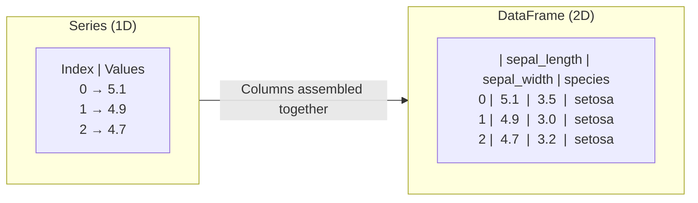

# Pandas: The Complete Reference (Beginner → Advanced)

> The industry standard data manipulation & engineering library. Every real-world ML dataset pipeline starts here.

---

## 1. Core Data Structures



| Structure | Description | Creation Syntax |
| :--- | :--- | :--- |
| **Series** | 1D labeled array (a single column) | `pd.Series([1, 2, 3])` |
| **DataFrame** | 2D labeled table (rows × columns) | `pd.DataFrame({"col1": [1, 2], "col2": [3, 4]})` |

---

## 2. Ingestion & Serialization

| Function | Syntax | Description |
| :--- | :--- | :--- |
| `pd.read_csv` | `pd.read_csv("data.csv")` | Load CSV into DataFrame. |
| `pd.read_excel` | `pd.read_excel("data.xlsx")` | Load Excel workbook sheet. |
| `pd.read_parquet` | `pd.read_parquet("data.parquet")` | Fast columnar format for large datasets. |
| `pd.read_json` | `pd.read_json("data.json")` | Ingest nested or flat JSON. |
| `.to_csv` | `df.to_csv("out.csv", index=False)` | Save CSV without writing unwanted index column. |
| `.to_parquet` | `df.to_parquet("out.parquet")` | Compressed binary export for training sets. |

---

## 3. Data Inspection & Health Check

| Function / Property | What It Audits | Practical Use Case |
| :--- | :--- | :--- |
| `df.shape` | `(rows, cols)` tuple | Check dataset dimensions. |
| `df.head(n)` / `.tail(n)` | First / last $n$ rows | Visual inspection of features and labels. |
| `df.info()` | Column names, dtypes, null counts | Spots wrong datatypes & missing values. |
| `df.describe()` | Count, mean, std, min, 25%, 50%, max | Feature distribution overview. |
| `df.isnull().sum()` | Missing value counter per column | Pinpoint columns needing imputation. |
| `df.nunique()` | Count unique values per column | Differentiate categories from continuous numbers. |
| `df["col"].value_counts()` | Frequency count of each category | Inspect class imbalance. |
| `df.dtypes` | Types of each column | `float64`, `int64`, `object`, etc. |

---

## 4. Selection, Slicing & The `.values` Bridge

| Syntax | Returns | Description |
| :--- | :--- | :--- |
| `df["col"]` | 1D Series | Select single column. |
| `df[["col1", "col2"]]` | 2D DataFrame | Select multiple columns by list. |
| `df[features]` | 2D DataFrame | Select columns via list variable. |
| `df.iloc[i]` | Series | Select row by integer index position. |
| `df.iloc[start:stop]` | DataFrame | Slice rows by integer position. |
| `df.loc[mask, cols]` | DataFrame / Series | Filter rows by boolean condition across specific columns. |
| `.values` or `.to_numpy()`| NumPy ndarray | **The Bridge**: Converts Pandas table into raw NumPy matrix. |

```python
# The Standard Machine Learning Extraction
features = ["sepal_length", "sepal_width", "petal_length", "petal_width"]
X = df[features].values   # Shape: (150, 4) -> NumPy Matrix
y = df["species"].values  # Shape: (150,)    -> NumPy Vector
```

---

## 5. Filtering & Boolean Indexing

| Syntax | Description | Example |
| :--- | :--- | :--- |
| `df[df["col"] > val]` | Greater than threshold | `df[df["Age"] > 30]` |
| `df[df["col"] == val]` | Exact match | `df[df["species"] == "setosa"]` |
| `df[df["col"].isin([...])]` | Belongs to set | `df[df["Embarked"].isin(["S", "C"])]` |
| `df[(c1) & (c2)]` | AND condition | `df[(df["Age"] > 18) & (df["Sex"] == 1)]` |
| `df[(c1) | (c2)]` | OR condition | `df[(df["Pclass"] == 1) | (df["Pclass"] == 2)]` |
| `df[~condition]` | NOT condition | Negate a boolean mask |

---

## 6. Missing Value Imputation

| Method | Syntax | Strategy |
| :--- | :--- | :--- |
| `df.drop(columns=[...])` | `df.drop(columns=["Cabin"])` | Drop column if $>50\%$ missing. |
| `df.dropna(subset=[...])` | `df.dropna(subset=["Embarked"])` | Drop rows with missing values in key targets. |
| `df["col"].fillna(median)`| `df["Age"].fillna(df["Age"].median())` | Continuous feature imputation. |
| `df["col"].fillna(mode)` | `df["Port"].fillna(df["Port"].mode()[0])` | Categorical feature imputation. |
| `df.ffill()` / `df.bfill()`| `df.ffill()` | Forward/backward fill for time-series. |

---

## 7. Categorical Encoding & Feature Engineering

| Technique | Syntax | Use Case |
| :--- | :--- | :--- |
| **Dictionary Mapping** | `df["Sex"].map({"female": 0, "male": 1})` | Binary or explicit ordinal categories. |
| **One-Hot Encoding** | `pd.get_dummies(df, columns=["Embarked"])` | Convert nominal categories into binary flag columns. |
| **Binning (Equal Width)**| `pd.cut(df["Age"], bins=4)` | Group ages into discrete buckets. |
| **Binning (Quantiles)** | `pd.qcut(df["Fare"], q=4)` | Group fares into 4 equal-count quartiles. |
| **Row Transformations** | `df.apply(lambda row: ..., axis=1)` | Custom cross-column feature creation. |
| **String Operations** | `df["Name"].str.extract(r"([A-Za-z]+)\.")` | Text pattern extraction using regex. |

---

## 8. GroupBy & Split-Apply-Combine

| Syntax | Description | Example |
| :--- | :--- | :--- |
| `df.groupby("col").mean()` | Group average | Average features per flower species |
| `df.groupby("col").agg(...)` | Multi-column metrics | `df.groupby("Pclass").agg({"Age": "median", "Fare": "mean"})` |
| `df.groupby("col").size()` | Group counts | Frequency per class |
| `pd.crosstab(df["c1"], df["c2"])`| Contingency table | Cross-tabulate two categorical columns |
