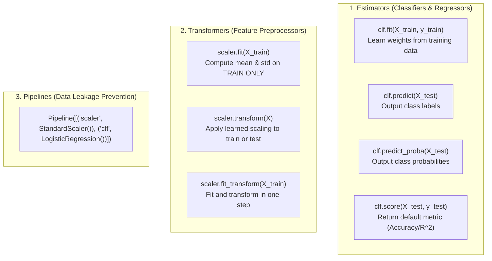
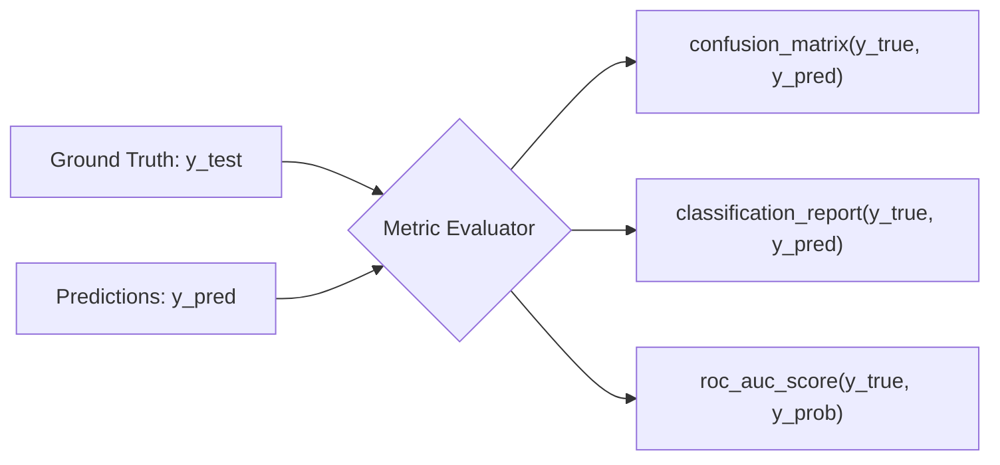

# Scikit-Learn: The Complete Reference (Beginner → Advanced)

> The gold-standard machine learning library for statistical modeling, evaluation, and end-to-end pipelines.

---

## 1. The Core Architecture (Estimator / Transformer Paradigm)

Every component in Scikit-Learn follows an identical object-oriented interface:



---

## 2. Preprocessing & Feature Scaling (`sklearn.preprocessing`)

| Transformer Class | Mathematical Formulation | Important Note |
| :--- | :--- | :--- |
| `StandardScaler()` | $z = \frac{x - \mu}{\sigma}$ | Z-score standardization. Fit **only** on train data. |
| `MinMaxScaler()` | $z = \frac{x - x_{\min}}{x_{\max} - x_{\min}}$ | Scales to $[0, 1]$. Sensitive to outliers. |
| `RobustScaler()` | $z = \frac{x - Q_2}{Q_3 - Q_1}$ | Uses median & IQR; resilient to severe anomalies. |
| `OneHotEncoder()` | Category $\to$ binary vector | Set `handle_unknown="ignore"` for production resilience. |
| `OrdinalEncoder()` | Category $\to$ integer $0 \dots C-1$ | Use only for features with true rank/order. |
| `LabelEncoder()` | Target $y \to$ integer $0 \dots C-1$ | For 1D target vectors only. |

---

## 3. Dataset Splitting & Resampling (`sklearn.model_selection`)

| Class / Function | Description | Example / Best Practice |
| :--- | :--- | :--- |
| `train_test_split` | Split data into train & test sets | `train_test_split(X, y, test_size=0.2, random_state=42, stratify=y)` |
| `stratify=y` | Critical parameter | Enforces identical class ratios in train and test splits. |
| `KFold(n_splits=5)` | Standard $K$-fold cross-validation | Shuffles and partitions into $K$ test folds. |
| `StratifiedKFold` | Stratified $K$-fold | Preserves class percentages in each fold. |
| `cross_val_score` | Evaluates score across all folds | `cross_val_score(model, X, y, cv=5, scoring="accuracy")` |

---

## 4. Algorithms Reference

### Classification Models

| Algorithm | Class Import | Key Hyperparameters |
| :--- | :--- | :--- |
| **Logistic Regression** | `linear_model.LogisticRegression` | `max_iter=1000`, `C=1.0` (inverse regularization) |
| **Random Forest** | `ensemble.RandomForestClassifier` | `n_estimators=100`, `max_depth=None`, `random_state=42` |
| **Gradient Boosting** | `ensemble.GradientBoostingClassifier`| `learning_rate=0.1`, `n_estimators=100`, `max_depth=3` |
| **Support Vector Classifier** | `svm.SVC` | `C=1.0`, `kernel="rbf"`, `probability=True` |
| **K-Nearest Neighbors** | `neighbors.KNeighborsClassifier` | `n_neighbors=5`, `metric="minkowski"` |
| **Decision Tree** | `tree.DecisionTreeClassifier` | `max_depth=5`, `min_samples_split=2` |

### Regression Models

| Algorithm | Class Import | Key Hyperparameters |
| :--- | :--- | :--- |
| **Linear Regression** | `linear_model.LinearRegression` | Standard Ordinary Least Squares (OLS) |
| **Ridge Regression** | `linear_model.Ridge` | L2 penalty: `alpha=1.0` |
| **Lasso Regression** | `linear_model.Lasso` | L1 penalty: `alpha=1.0` (Feature selection) |
| **Random Forest Regressor** | `ensemble.RandomForestRegressor` | `n_estimators=100`, `max_depth=10` |

---

## 5. Model Evaluation Suite (`sklearn.metrics`)



### Classification Metrics

| Function | Mathematical Definition | When to Use |
| :--- | :--- | :--- |
| `accuracy_score(y, y_pred)` | $\frac{TP + TN}{\text{Total}}$ | Balanced datasets only. |
| `confusion_matrix(y, y_pred)` | 2D matrix of True vs Predicted | Diagnosing specific class confusions. |
| `classification_report(y, y_pred)` | Table of Precision, Recall, F1 | Quick multi-class diagnostic overview. |
| `precision_score(y, y_pred)` | $\frac{TP}{TP + FP}$ | When cost of False Positives is high (e.g. spam filter). |
| `recall_score(y, y_pred)` | $\frac{TP}{TP + FN}$ | When cost of False Negatives is high (e.g. cancer detection). |
| `f1_score(y, y_pred)` | $2 \cdot \frac{P \cdot R}{P + R}$ | Harmonizing precision and recall on imbalanced data. |
| `roc_auc_score(y, y_prob)` | Area Under ROC Curve | Threshold-independent discrimination power. |

### Regression Metrics

| Function | Formula | Interpretation |
| :--- | :--- | :--- |
| `mean_squared_error(y, y_pred)` | $\frac{1}{n}\sum(y - \hat{y})^2$ | Penalizes large errors heavily. |
| `root_mean_squared_error(y, y_pred)` | $\sqrt{\text{MSE}}$ | Error in original units of the target. |
| `mean_absolute_error(y, y_pred)` | $\frac{1}{n}\sum \|y - \hat{y}\|$ | Average absolute magnitude of errors. |
| `r2_score(y, y_pred)` | $1 - \frac{\sum(y - \hat{y})^2}{\sum(y - \bar{y})^2}$ | Proportion of variance explained by model ($1.0$ = perfect). |

---

## 6. Production Pipelines (`Pipeline` & `ColumnTransformer`)

Pipelines chain preprocessing and modeling into a single encapsulated object, preventing data leakage during cross-validation.

```python
from sklearn.pipeline import Pipeline
from sklearn.compose import ColumnTransformer
from sklearn.preprocessing import StandardScaler, OneHotEncoder
from sklearn.impute import SimpleImputer
from sklearn.ensemble import RandomForestClassifier

# 1. Transformers per modality
num_transformer = Pipeline([
    ("imputer", SimpleImputer(strategy="median")),
    ("scaler", StandardScaler())
])

cat_transformer = Pipeline([
    ("imputer", SimpleImputer(strategy="most_frequent")),
    ("encoder", OneHotEncoder(handle_unknown="ignore"))
])

# 2. Bind transformers to feature column names
preprocessor = ColumnTransformer(transformers=[
    ("num", num_transformer, ["Age", "Fare"]),
    ("cat", cat_transformer, ["Sex", "Embarked"])
])

# 3. Create unified pipeline
pipeline = Pipeline([
    ("preprocessor", preprocessor),
    ("classifier", RandomForestClassifier(n_estimators=100, random_state=42))
])

# Fit and predict cleanly
pipeline.fit(X_train_df, y_train)
y_pred = pipeline.predict(X_test_df)
```

---

## 7. Hyperparameter Tuning (`sklearn.model_selection`)

| Class | Strategy | Best For |
| :--- | :--- | :--- |
| `GridSearchCV(model, param_grid, cv=5)` | Exhaustive grid search over all combinations | Small parameter grids ($< 100$ combinations). |
| `RandomizedSearchCV(model, param_dist, n_iter=50)` | Randomly samples $N$ hyperparameter points | Large parameter search spaces. |
