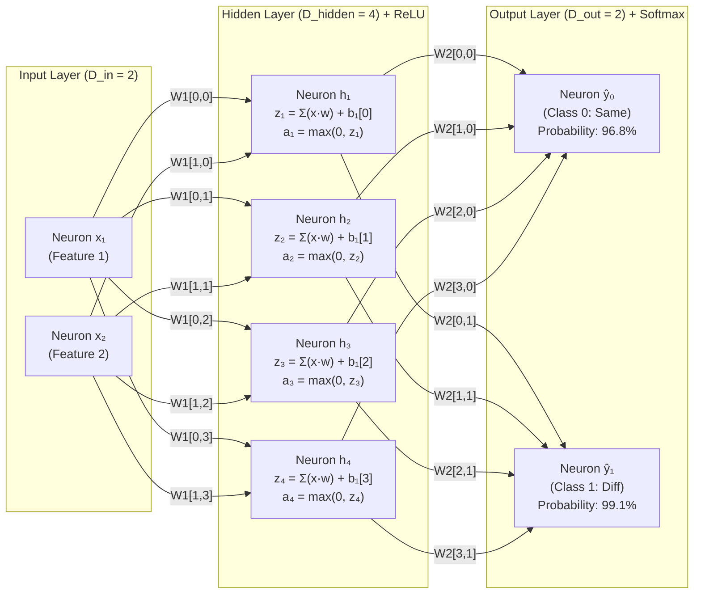
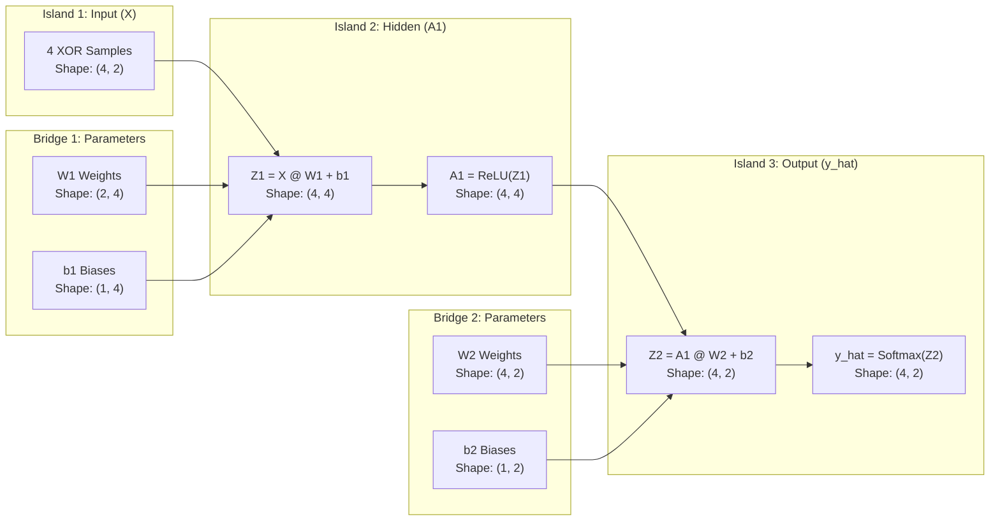
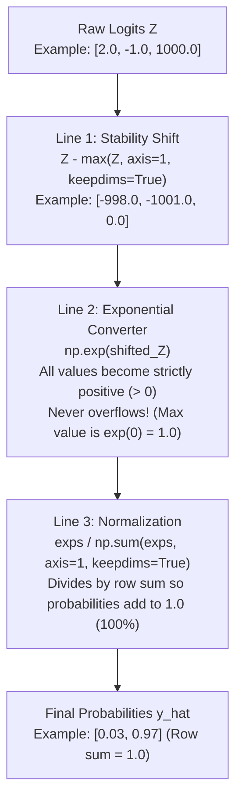
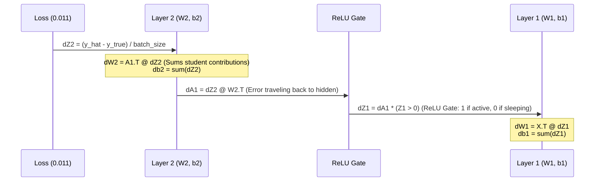
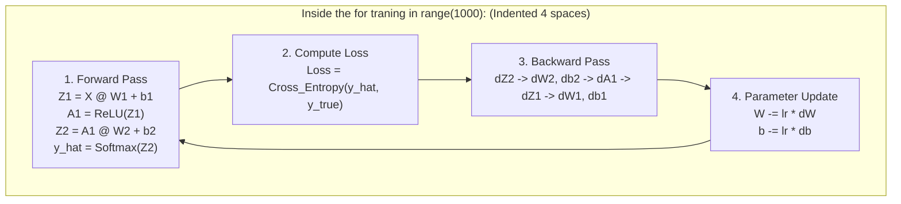

# Lab 1: Visual Deconstruction & Master Reference
## The XOR Problem, Linear Collapse, and the Non-Linear Revolution

---

## 0. The Complete Neural Network Node Architecture (2-4-2 Graph)

Here is the exact blueprint of the physical network you built in code, showing every individual neuron, weight connection, bias, and activation function:



### The Physical Flow Inside Every Neuron:
Look at a single hidden neuron, say **$h_1$**:
1. It receives a signal from $x_1$ through weight $W_{1}[0, 0]$.
2. It receives a signal from $x_2$ through weight $W_{1}[1, 0]$.
3. It adds them together with its bias: $z_1 = (x_1 \cdot W_1[0, 0]) + (x_2 \cdot W_1[1, 0]) + b_1[0]$.
4. It passes that sum through **$\text{ReLU}$**: $a_1 = \max(0, z_1)$.
5. It then sends $a_1$ forward along two paths: to $ŷ_0$ (via $W_2[0, 0]$) and to $ŷ_1$ (via $W_2[0, 1]$).

---

## 1. The Core Mystery: The 2D Geometry of XOR

Look at the 4 data points of XOR plotted on a 2D coordinate grid:

```text
    x2 (Feature 2)
     ^
 1.0 |    [0, 1] = CLASS 1 (Pass)         [1, 1] = CLASS 0 (Fail)
     |           (Blue)                          (Red)
     |
     |
 0.0 |    [0, 0] = CLASS 0 (Fail)         [1, 0] = CLASS 1 (Pass)
     |           (Red)                           (Blue)
     +------------------------------------------------------------> x1 (Feature 1)
         0.0                             1.0
```

### The Linear Failure (No ReLU)
Try to draw a single straight ruler line that puts all the **Blue (Class 1)** points on one side and all the **Red (Class 0)** points on the other side.
- A vertical line fails.
- A horizontal line fails.
- A diagonal line fails.

**It is geometrically impossible for a single straight line to separate these points.** 
Because a purely linear network can only draw straight lines, its loss was permanently trapped at:
$$\text{Loss} = -\ln(0.5) = \mathbf{0.693147} \quad (\text{Pure 50/50 Guessing})$$

### The Non-Linear Solution (With ReLU)
When you added $\text{ReLU}(Z_1)$, the network did not stay in flat 2D space. 
It **bent and folded the coordinate system into 4 dimensions** ($D_{hidden} = 4$), allowing a flat 4D hyperplane to slice right through and separate the points cleanly!

---

## 2. The Dimensional Architecture: "Students & Detectives"

Here is how data and weights interacted inside your network during Lab 1:



### The Dimensional Ledger:
| Entity | Variable | Shape | Meaning |
| :--- | :--- | :--- | :--- |
| **Input** | `X` | `(4, 2)` | 4 samples, 2 coordinate features each |
| **Layer 1 Weights** | `W1` | `(2, 4)` | Connects 2 inputs to 4 detective neurons |
| **Layer 1 Bias** | `b1` | `(1, 4)` | Baseline shifts for each detective |
| **Hidden Features** | `A1` | `(4, 4)` | 4 samples $\times$ 4 detective feature activations |
| **Layer 2 Weights** | `W2` | `(4, 2)` | Connects 4 detectives to 2 output classes |
| **Layer 2 Bias** | `b2` | `(1, 2)` | Baseline shifts for Class 0 and Class 1 |
| **Probabilities** | `y_hat` | `(4, 2)` | 4 samples $\times$ 2 class probabilities (sums to 1.0) |

---

## 3. The Math of Linear Collapse (Why Skipping ReLU Broke the AI)

When you connected Layer 1 directly to Layer 2 without `relu`:
$$\mathbf{Z}_1 = \mathbf{X} \mathbf{W}_1 + \mathbf{b}_1$$
$$\mathbf{Z}_2 = \mathbf{Z}_1 \mathbf{W}_2 + \mathbf{b}_2$$

Substituting $\mathbf{Z}_1$ directly into $\mathbf{Z}_2$:
$$\mathbf{Z}_2 = (\mathbf{X} \mathbf{W}_1 + \mathbf{b}_1) \mathbf{W}_2 + \mathbf{b}_2 = \mathbf{X} (\mathbf{W}_1 \mathbf{W}_2) + (\mathbf{b}_1 \mathbf{W}_2 + \mathbf{b}_2)$$

Notice the collapse:
- $(\mathbf{W}_1 \mathbf{W}_2)$ is just a single $(2 \times 2)$ matrix $\mathbf{W}_{\text{collapsed}}$.
- $(\mathbf{b}_1 \mathbf{W}_2 + \mathbf{b}_2)$ is just a single $(1 \times 2)$ vector $\mathbf{b}_{\text{collapsed}}$.

> **The Lesson**: No matter how many linear layers you stack, they mathematically collapse into a single straight line. **Non-linearity (ReLU) is what makes a neural network "deep".**

---

## 4. Deconstructing the Softmax Function

Why did we write `softmax` the way we did?



### The Meaning of the Keywords:
- **`axis=1`**: Calculate horizontally across rows (per sample).
- **`keepdims=True`**: Keeps the shape as a 2D column `(4, 1)` instead of collapsing to 1D `(4,)`, so NumPy can broadcast division cleanly across rows.

---

## 5. Deconstructing Cross-Entropy Loss

$$\mathcal{L} = -\frac{1}{B} \sum_{i=1}^B \sum_{k=1}^C y_{i, k} \log(\hat{y}_{i, k} + \epsilon)$$

```text
Mistake Magnitude vs. Penalty:
Model Confidence in Correct Answer:    Loss Penalty:
1.00  (100% Sure & Right)       -----> -log(1.00) = 0.0000 (No penalty!)
0.968 (96.8% Sure & Right)      -----> -log(0.968) = 0.0325 (Tiny penalty)
0.50  (Random Guessing)         -----> -log(0.50)  = 0.6931 (Stuck here in Linear Collapse!)
0.01  (Arrogantly Wrong)        -----> -log(0.01)  = 4.6051 (Heavy punishment!)
```

- **Why $\epsilon = 10^{-15}$?** If the model predicts $0.0$, $\log(0)$ is $-\infty$ (crash). $\epsilon$ acts as a protective shield.

---

## 6. The Backward Pass Highway (Chain Rule)

During the backward pass, gradients flowed backwards through the exact reverse sequence:



### Why Transpose ($A_1^T$ and $X^T$)?
- $A_1$ has shape `(4, 4)` (4 samples, 4 detectives).
- $dZ_2$ has shape `(4, 2)` (4 samples, 2 class errors).
- We need $dW_2$ to have shape **`(4, 2)`** to match $W_2$.
- $A_1^T$ (shape `4 x 4`) multiplied by $dZ_2$ (shape `4 x 2`) computes the **dot product across all 4 samples**, summing their feedback into the weights in one single operation.

---

## 7. The Loop Body (Why Indentation Saved the Model)



Every single epoch:
1. Data flows **Forward**.
2. Error is **Measured**.
3. Gradients flow **Backward**.
4. Weights take a step **Downhill**.

By repeating this cycle 1,000 times, the weights navigated the 26-dimensional loss landscape and reached the bottom with **Loss = 0.0116**!
