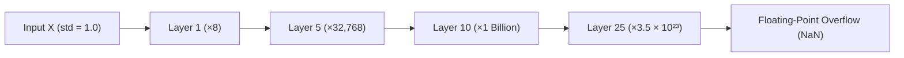
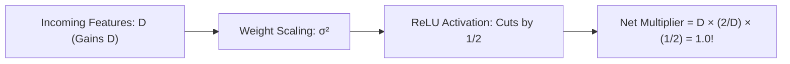

# Lab 2: Visual Deconstruction & Master Reference
## The "Bomb Test": Variance Explosion, Vanishing Signals, and the He/Kaiming Equilibrium

---

## 1. The Three Regimes of Deep Signal Propagation

During Lab 2, you ran 30 stacked layers and empirically uncovered the three fundamental states of signal propagation in deep neural networks:


---

## 2. The Physical Mechanism: Why Do Unscaled Weights Explode?

Look at what a single neuron computes when it multiplies 64 inputs by 64 weights:

$$z = (x_1 \cdot w_1) + (x_2 \cdot w_2) + (x_3 \cdot w_3) + \dots + (x_{64} \cdot w_{64})$$

Think of it like rolling 64 dice:
- Each individual multiplication $(x_i \cdot w_i)$ has variance $\approx 1.0$.
- When you add 64 independent random variables together, **their variances add up**:

$$\text{Variance of Output } z \approx 64 \times 1.0 = \mathbf{64}$$

In statistics, the **spread (standard deviation)** is the square root of variance:
$$\text{std}(z) = \sqrt{\text{Variance}} = \sqrt{64} = \mathbf{8.0}$$

Every single unscaled layer **multiplies the spread by 8**:
- Layer 1: $1 \times 8 = \mathbf{8}$
- Layer 2: $8 \times 8 = \mathbf{64}$
- Layer 3: $64 \times 8 = \mathbf{512}$
- Layer 5: $8^5 = \mathbf{32,768}$
- Layer 10: $8^{10} \approx \mathbf{1,073,741,824}$ (1 Billion!)
- Layer 25: $8^{25} \approx \mathbf{3.7 \times 10^{22}}$ (Sextillions!)



---

## 3. The Mystery of the 2.0: Why Did `1.0 / 64` Fade to Zero?

When you ran:
`W = np.random.randn(64, 64) * np.sqrt(1.0 / 64)` with `X = np.maximum(0, Z)`

The spread shrank on every layer: $0.58 \rightarrow 0.10 \rightarrow 0.02 \rightarrow 0.0006 \rightarrow 0.0$.

### Why did it die? The "50% Guillotine" of ReLU

Look at the bell curve of activations entering ReLU:
- Exactly **50% of the numbers are positive** (kept alive).
- Exactly **50% of the numbers are negative** (chopped to 0.0).

```text
Incoming Bell Curve:              After ReLU (Guillotine):
       ▲                                 ▲
     / | \                             / | \
    /  |  \                           /  |  \
---/---|---\---                    ---|--|---\---
 -2   0   +2                          0  +2
 (50% Negative) (50% Positive)     (All Negatives Dropped to 0)
                                   --> EXACTLY HALF THE ENERGY IS LOST!
```

Because ReLU discards half the variance on every single layer ($\times \frac{1}{2}$):
- If you scale weights by $\sqrt{\frac{1.0}{D}}$, the network loses half its signal power at every layer:
  $$\text{Layer } n = \left(\frac{1}{2}\right)^n$$
- In 10 layers, the signal power is $\left(\frac{1}{2}\right)^{10} = \frac{1}{1024}$ of its original strength.
- In 20 layers, it is $\frac{1}{1,000,000}$. The signal fades into total silence!

---

## 4. The Mathematical Derivation: Why $\sqrt{\frac{2.0}{D}}$ (Kaiming He, 2015)

To keep the signal alive at variance $\approx 1.0$ through 100 layers, we must solve this equation:

$$\text{Output Variance} = \text{Input Variance}$$

Let $D = 64$ be the number of incoming features:
1. The linear sum contributes a multiplier of $D$:
   $$\text{Linear Gain} = D$$
2. The weight variance is $\sigma_w^2$:
   $$\text{Weight Multiplier} = \sigma_w^2$$
3. ReLU cuts the variance in half ($\times \frac{1}{2}$):
   $$\text{ReLU Loss} = \frac{1}{2}$$

Combine all three factors:
$$\text{Net Signal Multiplier} = D \times \sigma_w^2 \times \frac{1}{2}$$

For the signal to remain perfectly constant (neither exploding nor vanishing), the Net Multiplier must equal **$1.0$**:

$$D \times \sigma_w^2 \times \frac{1}{2} = 1.0$$

Now, solve for the weight variance $\sigma_w^2$:

$$\sigma_w^2 = \frac{2.0}{D}$$

Take the square root to get the standard deviation scaling factor:

$$\mathbf{\text{scale} = \sqrt{\frac{2.0}{D}}}$$



The **$2.0$** is there solely to **double the energy** to cancel out ReLU's 50% chop!

---

## 5. Summary Table: What You Empirically Verified

| Scaling Formula | Non-Linearity | Behavior | Real-World Consequence |
| :--- | :--- | :--- | :--- |
| **None** (`1.0`) | Linear or ReLU | **Explosion** ($10^{23}$) | Memory overflows, weights become `inf`/`NaN`, model crashes. |
| **$\sqrt{1.0 / D}$** (Xavier) | Pure Linear | **Stable** ($\approx 1.0$) | Perfect for linear models and Sigmoid/Tanh activations. |
| **$\sqrt{1.0 / D}$** (Xavier) | **ReLU** | **Vanishing** ($0.0006$) | Signal dies to zero, neurons go permanently silent. |
| **$\sqrt{2.0 / D}$** (He / Kaiming) | **ReLU** | **Equilibrium** ($\approx 1.0$) | **Standard for modern AI** (ResNets, Transformers, LLMs). |

You now hold the physical and mathematical intuition that underpins weight initialization in modern deep learning!
