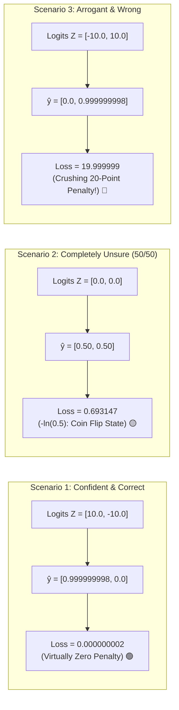
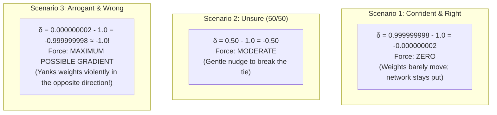

# Lab 3: Visual Deconstruction & Master Reference
## The "Lie Detector": Softmax & Cross-Entropy Dynamics

---

## 1. The Three Empirical Scenarios Tested

In Lab 3, you tested the mathematical machinery of Softmax and Cross-Entropy under controlled laboratory conditions, yielding this exact progression:



---

## 2. The Exponential Penalty Curve ($-\log(\hat{y})$)

Look at the shape of the negative natural logarithm curve:

```text
Loss Penalty (L)
   ^
20 |                                   * (Scenario 3: Confident & Wrong: p = 2.06e-9, Loss = 20.0)
   |                                   |
15 |                                   |
   |                                   |  <-- EXPONENTIAL ESCALATION ZONE
10 |                                   |      (The "Lie Detector" explodes)
   |                                   |
 5 |                                   *
   |                                  /
 1 |                                 /
0.69                             ---*--- (Scenario 2: 50/50 Coin Flip: p = 0.50, Loss = 0.693)
   |                             /
 0 +----------------------------*-----------------------------------------> Predicted Probability (p)
  0.0                          0.5                                      1.0
                                                                         * (Scenario 1: Confident & Right: p ≈ 1.0, Loss ≈ 0.0)
```

### Why Does It Escalate So Violently?
- The difference in probability between **$0.99$** and **$0.50$** changes the loss by only $\approx 0.68$.
- But as probability drops toward zero ($0.000000002$), the negative logarithm shoots toward infinity!
- This mathematical curvature ensures an AI **can never ignore an arrogant mistake**.

---

## 3. The Gradient Reaction Force: How Loss Translates to Muscle

Remember the output gradient formula you proved in Lab 1:
$$\delta = \hat{y} - y_{\text{true}}$$

Look at the gradient force generated in each scenario for the true class ($y_{\text{true}} = 1.0$):



When the model is arrogantly wrong, $\delta \approx -1.0$—the **strongest corrective force mathematics allows**!

---

## 4. The Shield: Why $\epsilon = 10^{-15}$ is Mandatory

In `Cross_entropy_loss`:
```python
loss = -np.sum(y_true * np.log(y_pred + eps)) / y_true.shape[0]
```

What if a model outputs a probability of **strictly $0.0$** and you don't have $\epsilon$?
$$\log(0.0) = -\infty \quad (\text{Negative Infinity})$$

In Python:
```python
-np.log(0.0)  # Returns inf!
0.0 * np.inf  # Returns NaN (Not a Number)!
```
Once a single `NaN` enters the network, all future weights become `NaN` in the next multiplication, permanently destroying the AI model. 
Adding $\epsilon = 10^{-15}$ guarantees that even if $y_{\text{pred}} = 0.0$, the computer computes $-\log(10^{-15}) \approx 34.5$, penalizing the network heavily without crashing computer memory!

---

## 5. Master Summary Table

| Metric | Scenario 1 (Right) | Scenario 2 (Unsure) | Scenario 3 (Wrong) |
| :--- | :--- | :--- | :--- |
| **Input Logits ($Z$)** | `[10.0, -10.0]` | `[0.0, 0.0]` | `[-10.0, 10.0]` |
| **Softmax Output ($\hat{y}$)** | `[0.999999998, 2.06e-9]` | `[0.50, 0.50]` | `[2.06e-9, 0.999999998]` |
| **True Label ($y_{\text{true}}$)** | `[1, 0]` (Class 0) | `[1, 0]` (Class 0) | `[1, 0]` (Class 0) |
| **Loss Penalty** | **$0.000000002$** | **$0.693147$** | **$19.999999$** |
| **Corrective Force ($\delta$)** | $-0.000000002$ (Rest) | $-0.500000000$ (Nudge) | **$-0.999999998$ (Max Force!)** |
