# Lab 4: Visual Deconstruction & Master Reference
## The Rollercoaster of Gradient Descent: Learning Rate Dynamics

---

## 1. The Three Trajectories in the Loss Valley

In Lab 4, you tested the parameter update equation:
$$\mathbf{W} \leftarrow \mathbf{W} - \eta \cdot \frac{\partial \mathcal{L}}{\partial \mathbf{W}}$$

By altering only the step size $\eta$ (learning rate), you observed three distinct physical behaviors in the loss landscape:

```mermaid
flowchart TD
    subgraph Snail ["Condition 1: The Snail (lr = 0.00001)"]
        S1["Epoch 0: Loss = 0.719157"] --> S2["Epoch 50: Loss = 0.718943"]
        S2 --> S3["Epoch 90: Loss = 0.718772\n(Total drop: 0.000385!) 🐌"]
        S3 --> S4["Outcome: Paralyzed. Needs 100,000+ epochs."]
    end

    subgraph Goldilocks ["Condition 2: The Goldilocks (lr = 0.1)"]
        G1["Epoch 0: Loss = 0.608687"] --> G2["Epoch 30: Loss = 0.262310"]
        G2 --> G3["Epoch 60: Loss = 0.140752"]
        G3 --> G4["Epoch 90: Loss = 0.085293\n(Smooth Descent into Valley!) ⛷️"]
        G4 --> G5["Outcome: Optimal, rapid convergence."]
    end

    subgraph Cannonball ["Condition 3: The Cannonball (lr = 100.0)"]
        C1["Epoch 0: Loss = 11.512925"] --> C2["Epoch 10: Slams into wall at 9.01"]
        C2 --> C3["Epoch 20: Leaps back across to 11.51"]
        C3 --> C4["Epoch 90: Still bouncing wildly (11.51) 💥"]
        C4 --> C5["Outcome: Overshoots valley floor; never settles."]
    end
```



---

## 2. Geometric Visualization: The Bowl Problem

Imagine the loss landscape as a U-shaped valley (a bowl) where the bottom of the bowl is the ideal weight with minimum error:

```text
Loss L(w)
   ^
   |        (Start: w0)
11 |         *                                         * (Epoch 0 & 20: 11.51)
   |          \                                       /
 9 |           \                 ------------------->* (Epoch 10 & 40: 9.01)
   |            \               /                   /
   |             \  (Goldilocks: lr=0.1)           /
   |              *  Smooth Glide                 /
 1 |               \                             /  (Cannonball: lr=100.0)
   |                *                           /    Giant violent leap clean
   |                 \                         /     across the valley!
 0 |                  *                       /
   +--------------------*--------------------*-----------------------------> Weight Parameter w
                     (Minimum Loss)
```

---

## 3. The Mathematics: Why Did `lr = 100` Bounce Forever?

In multivariable calculus, the gradient $g = \frac{\partial \mathcal{L}}{\partial w}$ points in the direction of steepest uphill ascent.
When we subtract $\eta \cdot g$, we take a linear step in the direction of steepest descent.

### The Curvature Threshold (Lipschitz Continuity)
For any curved bowl with curvature (second derivative) $L$:
1. **If $\eta < \frac{2}{L}$**: The step stays inside the bowl and is guaranteed to descend toward the bottom.
   - For `lr = 0.00001`: $\eta$ is tiny. The step is guaranteed to descend, but moves at a microscopic rate.
   - For `lr = 0.1`: $\eta$ is in the optimal sweet spot. It takes bold, efficient strides down to the minimum.
2. **If $\eta > \frac{2}{L}$**: The step size is larger than the entire width of the valley!
   - For `lr = 100.0`: The update vector $-\eta \cdot g$ is so massive that the weights overshoot the minimum completely, landing higher up on the opposite mountain wall.
   - On the next step, the gradient points back down, and the model overshoots in the opposite direction.
   - The weights enter a **limit cycle (oscillation)**, bouncing between `9.01` and `11.51` forever!

---

## 4. Master Empirical Comparison Table

Here is the exact terminal telemetry you recorded during Lab 4:

| Epoch | The Snail (`lr = 0.00001`) | The Goldilocks (`lr = 0.1`) | The Cannonball (`lr = 100.0`) |
| :--- | :--- | :--- | :--- |
| **Epoch 0** | `0.719157` | `0.608687` | `11.512925` (Overshoot) |
| **Epoch 10** | `0.719114` | `0.435803` | `9.016694` (Bounces) |
| **Epoch 20** | `0.719071` | `0.334192` | `11.512925` (Bounces back!) |
| **Epoch 30** | `0.719028` | `0.262310` | `11.512925` |
| **Epoch 40** | `0.718986` | `0.208685` | `9.018474` (Bounces again) |
| **Epoch 50** | `0.718943` | `0.167493` | `11.512925` |
| **Epoch 70** | `0.718857` | `0.118983` | `9.020250` |
| **Epoch 90** | `0.718772` | **`0.085293` (90% drop!)** | `11.512925` (Trapped) |
| **Diagnosis** | **Underfitting / Paralyzed** | **Optimal Convergence** | **Divergence / Oscillation** |

---

## 5. The Real-World Solution: Learning Rate Scheduling

In modern Large Language Models (like LLaMA and GPT), engineers solve this dilemma by using a **dynamic schedule**:
1. **Warmup Phase**: Start small (`lr ≈ 0.00001`) for the first few thousand steps so random weights don't explode.
2. **Peak Phase**: Ramp up to `lr = 0.001` to cross the plains quickly.
3. **Cosine Decay Phase**: Gradually shrink `lr` down toward zero as you near the bottom, allowing the model to settle gracefully into the deepest point of the valley without bouncing!
