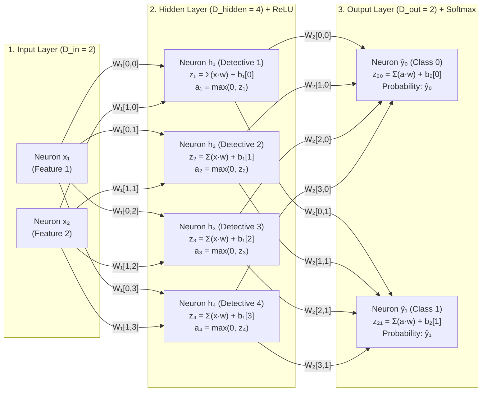
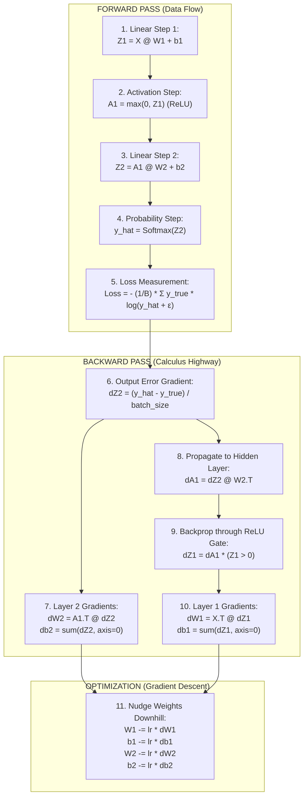

# Milestone 1: Master Visual Guide & Architecture Blueprint
## The Pure Math Neural Network: From First Principles to Convergence

---

## 1. The Complete Neural Network Architecture (The 2-4-2 Graph)

Below is the complete physical topology of the network you built in Milestone 1, detailing the inputs, weight connections, biases, activations, and probabilities:



---

## 2. The Dimensional Ledger (Shape Tracking)

To ensure matrix multiplication and broadcasting always align, every tensor in the pipeline adheres to these exact shapes:

| Symbol | Name | Shape in Milestone 1 | Shape Formula | Purpose |
| :--- | :--- | :--- | :--- | :--- |
| $\mathbf{X}$ | Input Batch | `(3, 2)` or `(4, 2)` | $(B, D_{in})$ | Batch of samples ($B$) with features ($D_{in}$) |
| $\mathbf{W}_1$ | Layer 1 Weights | `(2, 4)` | $(D_{in}, D_{hidden})$ | Connects inputs to hidden detective neurons |
| $\mathbf{b}_1$ | Layer 1 Biases | `(1, 4)` | $(1, D_{hidden})$ | Baseline shift for each hidden neuron |
| $\mathbf{Z}_1$ | Pre-Activation 1 | `(3, 4)` or `(4, 4)` | $(B, D_{hidden})$ | Raw linear sum: $\mathbf{X} \mathbf{W}_1 + \mathbf{b}_1$ |
| $\mathbf{A}_1$ | Activated Hidden | `(3, 4)` or `(4, 4)` | $(B, D_{hidden})$ | Post-ReLU features: $\max(0, \mathbf{Z}_1)$ |
| $\mathbf{W}_2$ | Layer 2 Weights | `(4, 2)` | $(D_{hidden}, D_{out})$ | Connects detectives to output classes |
| $\mathbf{b}_2$ | Layer 2 Biases | `(1, 2)` | $(1, D_{out})$ | Baseline shift for output classes |
| $\mathbf{Z}_2$ | Output Logits | `(3, 2)` or `(4, 2)` | $(B, D_{out})$ | Raw scores before normalization |
| $\mathbf{\hat{y}}$ | Probabilities | `(3, 2)` or `(4, 2)` | $(B, D_{out})$ | $\text{Softmax}(\mathbf{Z}_2)$, each row sums to $1.0$ |
| $\mathcal{L}$ | Total Loss | Scalar `()` | Scalar | Categorical cross-entropy error score |

---

## 3. The Complete Mathematical Highway

A neural network is a bidirectional highway: information moves **Forward** to calculate error, and calculus moves **Backward** to update the weights.



---

## 4. The 5 Foundational Pillars Visual Summary

Here is a visual reference for each of the 5 mathematical pillars:

```text
1. AFFINE TRANSFORMATION      2. RELU NON-LINEARITY        3. SOFTMAX PROBABILITIES
       Z = XW + b                    A = max(0, Z)            ŷ = exp(Z) / Σexp(Z)
          y                             Output                       Prob (Sum = 100%)
          ^                             ^                           ^
          |      * Transformed          |    / (Slope = 1.0)        | [ 96.8% ] Class 0
          |     /                       |   /                       | [  3.2% ] Class 1
          |    *                        |  /                        +------------------->
          +------------> x      --------+-------> Input z
         (Rotates & Shifts)     (Dead:0) (Active:z)         (Turns logits to probabilities)

4. CROSS-ENTROPY LOSS         5. GRADIENT DESCENT
    L = - Σ y log(ŷ)              w ← w - η(dL/dw)
       Loss (Penalty)                   Loss
       ^                                ^      * Start
    20 |     * (Wrong: 20.0)            |       \
       |     |                          |        \  Downhill steps
     1 |    /                           |         *
     0 +---*---------> p                +-----------*--------> w
       (0.0) (1.0)                               (Minimum)
    (The Lie Detector)                 (The Ball Rolling Down)
```

---

## 5. Summary of the 4 Empirical Labs

| Lab | Name | Core Question Explored | Scientific Discovery |
| :--- | :--- | :--- | :--- |
| **Lab 1** | **The XOR Problem** | What happens if we skip ReLU? | **Linear Collapse**: Two linear layers collapse into a flat line. Loss froze at `0.693147` (50% coin flip). Adding ReLU solved it to `0.011`. |
| **Lab 2** | **The Bomb Test** | Why scale weights by $\sqrt{2.0 / D}$? | **Variance Explosion vs Vanishing**: Unscaled weights exploded to $3.5 \times 10^{23}$. Scaling with $1.0$ died to $0.0006$. Scaling with $2.0$ held $\text{std} \approx 1.0$. |
| **Lab 3** | **The Lie Detector** | How does Cross-Entropy penalize error? | **Exponential Penalties**: Confident right = $0.000000002$. Unsure 50/50 = $0.693$. Arrogant wrong = $20.00$ (a 10-billion-fold penalty!). |
| **Lab 4** | **The Shootout** | What happens if learning rate is wrong? | **Overshooting**: Snail ($0.00001$) barely moved ($0.0003$). Goldilocks ($0.1$) descended smoothly ($0.085$). Cannonball ($100$) bounced violently between $9$ and $11.5$. |

---

## 6. The Training Engine Code Structure

```python
# ==========================================
# MILESTONE 1 MASTER ENGINE BLUEPRINT
# ==========================================
import numpy as np

# 1. Dimensions
input_dm = 2
hidden_dm = 4
output_dm = 2

# 2. He/Kaiming Initialized Parameters
W1 = np.random.randn(input_dm, hidden_dm) * np.sqrt(2.0 / input_dm)
b1 = np.zeros((1, hidden_dm))
W2 = np.random.randn(hidden_dm, output_dm) * np.sqrt(2.0 / hidden_dm)
b2 = np.zeros((1, output_dm))

# 3. Training Loop
lr = 0.1
epochs = 100

for epoch in range(epochs):
  # Forward Pass
  Z1 = X @ W1 + b1
  A1 = np.maximum(0, Z1)  # ReLU
  Z2 = A1 @ W2 + b2
  # Softmax
  exp_Z2 = np.exp(Z2 - np.max(Z2, axis=1, keepdims=True))
  y_hat = exp_Z2 / np.sum(exp_Z2, axis=1, keepdims=True)

  # Loss
  loss = -np.sum(y_true * np.log(y_hat + 1e-15)) / y_true.shape[0]

  # Backward Pass
  batch_size = y_true.shape[0]
  dZ2 = (y_hat - y_true) / batch_size
  dW2 = A1.T @ dZ2
  db2 = np.sum(dZ2, axis=0, keepdims=True)

  dA1 = dZ2 @ W2.T
  dZ1 = dA1 * (Z1 > 0)  # ReLU Gate
  dW1 = X.T @ dZ1
  db1 = np.sum(dZ1, axis=0, keepdims=True)

  # Parameter Update
  W1 -= lr * dW1
  b1 -= lr * db1
  W2 -= lr * dW2
  b2 -= lr * db2
```

You have mastered the foundational physics, mathematics, geometry, and code of neural networks!
