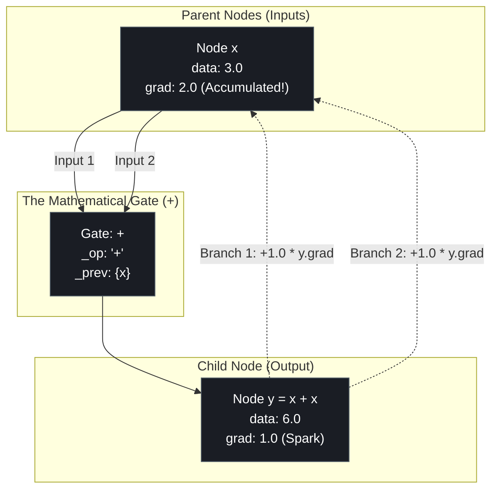
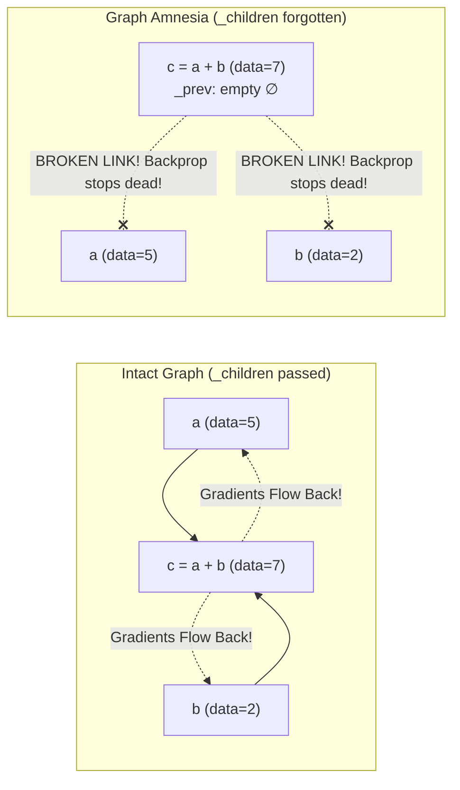
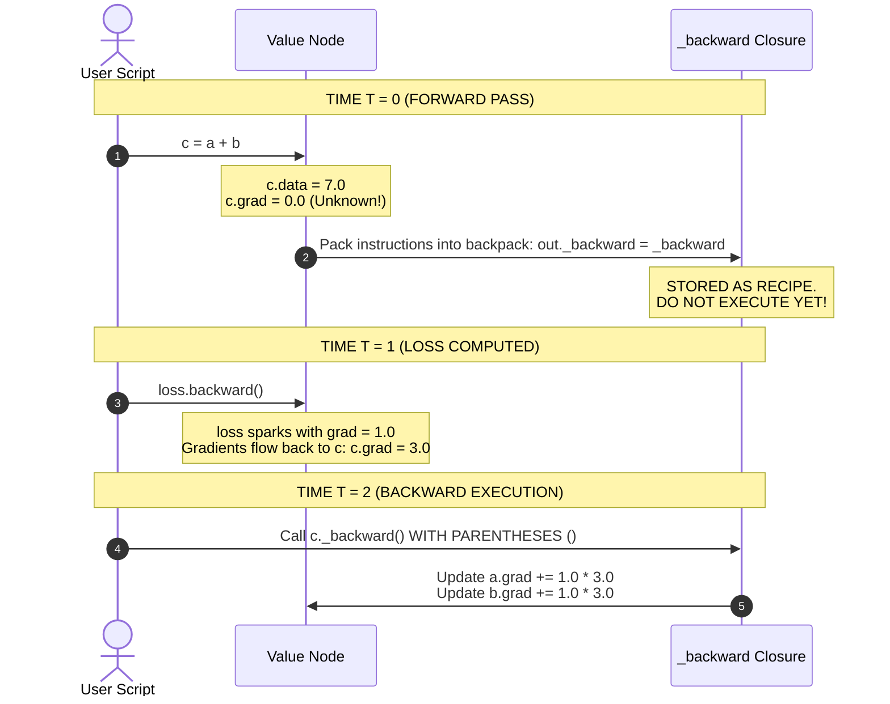

# Lab 1: Visual Deconstruction & Master Reference
## The Graph Amnesia, Accumulation Trap, and Computational Lineage

---

## 0. The Architecture of a Computational DAG Node

Every variable in an autograd engine is not just a raw number—it is a **node in a Directed Acyclic Graph (DAG)**. 

Below is the exact blueprint of how a node connects to its parents, stores its gradient, and remembers its local derivative:



---

## 1. Experiment 1: The Accumulation Trap (`+=` vs `=`)

One of the most insidious bugs in autograd engines is using `=` instead of `+=` inside `_backward()`.

### The Mathematical Proof ($y = x + x$):
Consider the equation:
$$y = x + x = 2x$$

From basic calculus, the derivative of $y$ with respect to $x$ is:
$$\frac{dy}{dx} = \mathbf{2.0}$$

This means: **If $x$ increases by $+1.0$, $y$ must increase by $+2.0$.**

---

### Why Does This Happen? (Multivariable Chain Rule)
In our computational graph, $x$ feeds into $y$ along **two separate paths**:
- Path 1: $x \longrightarrow y$ (contributes $+1.0 \times \text{out.grad}$)
- Path 2: $x \longrightarrow y$ (contributes $+1.0 \times \text{out.grad}$)

According to the multivariable chain rule, when a variable branches out, its total gradient is the **sum of gradients across all paths**:
$$\frac{\partial y}{\partial x} = \frac{\partial y}{\partial \text{Path}_1} + \frac{\partial y}{\partial \text{Path}_2} = 1.0 + 1.0 = \mathbf{2.0}$$

---

### The Two Code Realities:

```text
================================================================================
CASE A: The Broken Engine (Using "=")
================================================================================
def _backward():
    self.grad = 1.0 * out.grad       # Step 1: self.grad becomes 1.0
    other.grad = 1.0 * out.grad      # Step 2: other is ALSO self! Overwrites to 1.0!

Result: x.grad = 1.0  <-- COMPLETELY WRONG! Underestimates sensitivity by 50%!
================================================================================

================================================================================
CASE B: The Correct Engine (Using "+=")
================================================================================
def _backward():
    self.grad += 1.0 * out.grad      # Step 1: self.grad = 0.0 + 1.0 = 1.0
    other.grad += 1.0 * out.grad     # Step 2: self.grad = 1.0 + 1.0 = 2.0!

Result: x.grad = 2.0  <-- MATHEMATICALLY EXACT! Both branches accounted for!
================================================================================
```

---

## 2. Experiment 2: Graph Amnesia (The Disconnected DAG)

What happens if a programmer forgets to pass `_children` when creating an output node?

```python
# BROKEN Forward Pass:
def __add__(self, other):
    # Notice: No (self, other) passed as children!
    out = Value(self.data + other.data)  
    ...
```

### The Visual Fracture:


### Why Graph Amnesia is Dangerous:
1. **The Forward Pass Does Not Crash**: $5.0 + 2.0 = 7.0$ calculates normally. No error is raised!
2. **The Backward Pass Fails Silently**: When `c.backward()` runs:
   - `c` looks in `c._prev` to find who to send gradients to.
   - `c._prev` is empty!
   - `c` finishes immediately.
   - `a.grad` and `b.grad` remain permanently stuck at **`0.0`**!
   - The neural network **stops learning entirely** without printing a single error.

---

## 3. Experiment 3: The Closure Backpack (The Timing Dilemma)

Why do we write `out._backward = _backward` without parentheses `()`?

Let's look at the computer's timeline:



### What Happens If You Add Parentheses `()` Early?
If you wrote:
```python
out._backward = _backward()  # <--- Parentheses added during forward pass!
```
1. `_backward()` runs **immediately** during the forward pass.
2. At that moment, `out.grad` is still **`0.0`**.
3. It multiplies $1.0 \times 0.0$ and assigns $0.0$.
4. Then `_backward()` returns `None`, so `out._backward` becomes `None`!
5. When `backward()` is called later, Python crashes:
   `TypeError: 'NoneType' object is not callable`!

---

## 4. Summary: The 3 Golden Rules of Autograd

| Rule | The Code | Why It Is Mandatory |
| :--- | :--- | :--- |
| **Rule 1: Lineage** | `self._prev = set(_children)` | Gives the backward engine the road map to trace backward from Loss to Inputs. |
| **Rule 2: Accumulation** | `self.grad += local_slope * out.grad` | Prevents overwriting gradients when a node is reused in multiple branches ($y = x + x$). |
| **Rule 3: Lazy Execution** | `out._backward = _backward` | Keeps the backward recipe un-executed until the true incoming gradient has arrived. |
