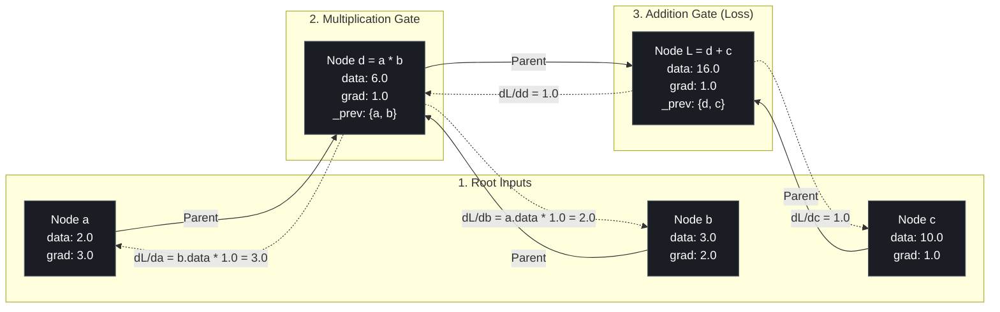
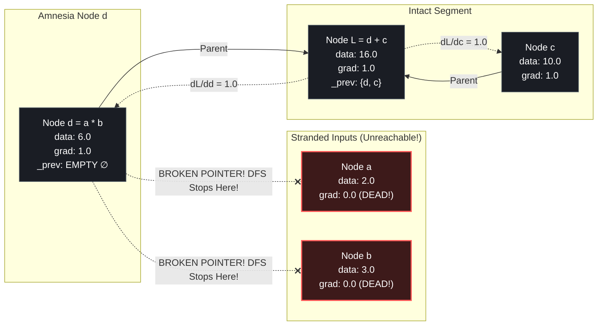

# Lab 2 (Milestone 2): Visual Deconstruction & Master Reference
## The Graph Amnesia Test: Severed Ancestry Chains and Silent Gradient Paralyzation

---

## 0. The Pipeline Architecture: The 4-Node Chain

In Lab 2, we built and tested a two-stage computational graph:
$$d = a \cdot b$$
$$L = d + c$$

Given the initial values:
- $a = 2.0$
- $b = 3.0$
- $c = 10.0$

### Forward Pass Evaluation:
1. $d = 2.0 \times 3.0 = \mathbf{6.0}$
2. $L = 6.0 + 10.0 = \mathbf{16.0}$

---

## 1. Case A: The Healthy Graph (Full Ancestry Memory)

In the healthy engine, every mathematical gate registers its parents in `_children`:
```python
out = Value(self.data * other.data, (self, other), _op="*")
```

### The Connected DAG Diagram:



### Verified Terminal Output (Healthy):
```text
----------------------------------------------------------------------------------------------------
Gradiant of A,B,C and D :
3.0   <-- (dL/da = b = 3.0)
2.0   <-- (dL/db = a = 2.0)
1.0   <-- (dL/dc = 1.0)
1.0   <-- (dL/dd = 1.0)
```
Every single node received its exact calculus gradient through the full chain!

---

## 2. Case B: The Amnesia Crime Scene (Severed Lineage)

Now, consider what happens when someone forgets to pass `(self, other)` when creating node $d$:
```python
out = Value(self.data * other.data, _op="*")  # <-- (self, other) is MISSING!
```

Inside computer memory:
- `d._prev` defaults to an **empty set `()`**.
- Node $d$ has completely forgotten that $a$ and $b$ created it.

### The Fractured Graph Diagram:



---

## 3. The Empirical Discovery: Why Silent Failures are Dangerous

Look at your terminal output when the lineage was severed:

```text
----------------------------------------------------------------------------------------------------
Gradiant of A,B,C and D :
0.0   <-- PARALYZED! Never received gradient!
0.0   <-- PARALYZED! Never received gradient!
1.0   <-- Healthy
1.0   <-- Healthy
```

### The 3 Key Lessons:
1. **The Forward Pass is Blind to Lineage**:
   $d = 2.0 \times 3.0 = 6.0$ and $L = 6.0 + 10.0 = 16.0$ computed without any problems. The computer showed zero warnings.
2. **Topological Sort Traversal Was Truncated**:
   When `build_topo(L)` executed:
   - It visited $L$, then visited $L$'s parents: $c$ and $d$.
   - At $d$, it checked `d._prev`. Finding nothing, it stopped!
   - Nodes $a$ and $b$ were **never added to `topo`**.
   - Their `_backward()` functions were never called!
3. **Zero Parameter Updates in Real Networks**:
   In gradient descent:
   $$W_{\text{new}} = W_{\text{old}} - \text{lr} \times W.\text{grad}$$
   If $W.\text{grad} = 0.0$:
   $$W_{\text{new}} = W_{\text{old}} - \text{lr} \times 0.0 = W_{\text{old}}$$
   The neural network **learns absolutely nothing**, despite running thousands of training epochs!

---

## 4. Production Diagnostic Playbook (PyTorch & Autograd)

This exact bug happens daily to machine learning engineers in production frameworks like PyTorch. Here is what causes it:

| The Mistake in Code | What Happens Under the Hood | The Symptom |
| :--- | :--- | :--- |
| **Omitting `_children`** | Node's `_prev` set is empty. | Upstream nodes get `grad = 0.0`. |
| **`tensor.detach()`** | Explicitly severs the node from PyTorch's backward autograd graph. | Gradients stop flowing past that tensor. |
| **Casting to NumPy (`.numpy()`)** | NumPy arrays do not have computational graphs. Breaks the DAG. | `AttributeError` or silent zero gradients. |
| **`torch.no_grad()`** | Disables graph construction globally during forward pass. | Forward pass runs faster, but `loss.backward()` crashes or does nothing. |
| **Forgetting `requires_grad=True`** | Leaves leaf nodes untracked by the autograd tape. | Parameters stay at `grad = None` or `0.0`. |
