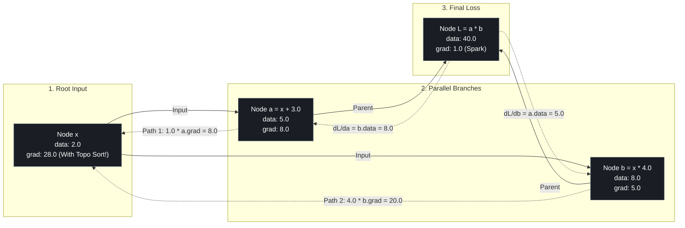
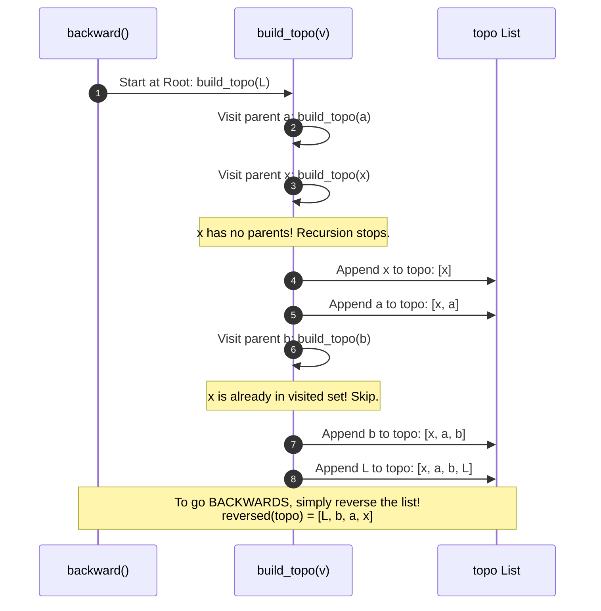

# Lab 3 (Milestone 2): Visual Deconstruction & Master Reference
## The Topological Order Jigsaw: Execution Order Chaos and Depth-First Search

---

## 0. The Diamond DAG Architecture

In Lab 3, we constructed a **Diamond Computational Graph** where an input node $x$ fans out into two parallel paths and recombines at an output gate:

$$x = 2.0$$
$$a = x + 3.0 \quad (\text{Path 1})$$
$$b = x \cdot 4.0 \quad (\text{Path 2})$$
$$L = a \cdot b \quad (\text{Merge Gate})$$



---

## 1. Mathematical Ground Truth (High School Calculus)

To know whether our autograd engine is correct, we solve the algebraic equation by hand:

$$L(x) = a(x) \cdot b(x) = (x + 3.0) \cdot (4.0x)$$
$$L(x) = 4x^2 + 12x$$

Applying the power and sum rules of differentiation:
$$\frac{dL}{dx} = \frac{d}{dx}(4x^2) + \frac{d}{dx}(12x) = 8x + 12$$

Evaluating at our input $x = 2.0$:
$$\frac{dL}{dx} = 8(2.0) + 12 = 16.0 + 12.0 = \mathbf{28.0}$$

---

## 2. The Execution Order Experiment: Reverse vs. Forward

The central question of Lab 3 was: **Why can't we loop through nodes in arbitrary or forward order?**

```text
================================================================================
CASE A: The Correct Engine (Reverse Topological Order via DFS)
================================================================================
Step 1: L._backward() executes FIRST:
        a.grad += b.data * 1.0 = 8.0
        b.grad += a.data * 1.0 = 5.0

Step 2: a._backward() executes SECOND:
        x.grad += 1.0 * a.grad = 1.0 * 8.0 = 8.0

Step 3: b._backward() executes THIRD:
        x.grad += 4.0 * b.grad = 4.0 * 5.0 = 20.0  --> Accumulated: 8.0 + 20.0 = 28.0!

TERMINAL OUTPUT:
X gradiant 28.0  <-- (EXACT MATCH WITH CALCULUS DERIVATIVE!)
================================================================================

================================================================================
CASE B: The Corrupted Engine (Forward Order / No Topological Reverse)
================================================================================
Step 1: x._backward() executes FIRST (Premature Execution!):
        At this millisecond: a.grad = 0.0 and b.grad = 0.0!
        x.grad += 1.0 * a.grad = 1.0 * 0.0 = 0.0
        x.grad += 4.0 * b.grad = 4.0 * 0.0 = 0.0

Step 2: a._backward() and b._backward() execute SECOND:
        Gradients arrive from L, but x has ALREADY finished executing!

TERMINAL OUTPUT:
X gradiant 0.0   <-- (TOTAL DERIVATIVE BLACKOUT!)
================================================================================
```

---

## 3. How Depth-First Search (DFS) Guarantees Correct Order

The algorithm implemented inside `backward()` uses recursion to guarantee that no node is processed until its dependencies are satisfied:



### The Invariant Rule:
> In `reversed(topo)`:
> **Every child is guaranteed to appear BEFORE any of its parents.**
> Therefore, when a node executes, its incoming gradient (`out.grad`) is 100% complete and finalized!

---

## 4. Summary: The Shoes and Socks Rule

| Execution Step | Forward Pass | Backward Pass | What Happens if Violated |
| :--- | :--- | :--- | :--- |
| **Step 1** | Put on socks ($x$) | Take off shoes ($L$) | Shoes cannot be removed over socks. |
| **Step 2** | Put on pants ($a, b$) | Take off pants ($a, b$) | Pants trapped inside shoes. |
| **Step 3** | Put on shoes ($L$) | Take off socks ($x$) | Gradients become $0.0$ or corrupted garbage. |
