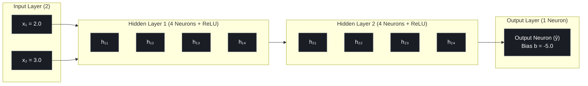
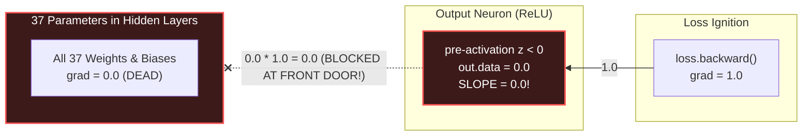
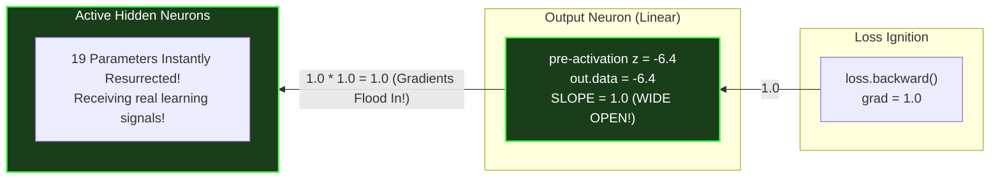

# Lab 4 (Milestone 2): Visual Deconstruction & Master Reference
## The Dead ReLU Epidemic & The Linear Output Rescue

---

## 1. The 37-Parameter MLP Architecture

In Lab 4, we evaluated the full 3-layer neural network `MLP(2, [4, 4, 1])`:



### Parameter Breakdown Ledger:
- **Layer 1** ($2 \to 4$): 4 neurons $\times$ (2 weights + 1 bias) = **12 parameters**
- **Layer 2** ($4 \to 4$): 4 neurons $\times$ (4 weights + 1 bias) = **20 parameters**
- **Layer 3** ($4 \to 1$): 1 neuron $\times$ (4 weights + 1 bias) = **5 parameters**
- **Total Parameters:** $12 + 20 + 5 = \mathbf{37 \text{ parameters}}$

---

## 2. The Light Switch Mechanics of ReLU

Mathematically, ReLU acts as a one-way electrical gate:
$$\text{ReLU}(z) = \max(0, z)$$

$$\frac{\partial \text{ReLU}}{\partial z} = \begin{cases} 1.0 & z > 0 \quad (\text{Switch ON}) \\ 0.0 & z \le 0 \quad (\text{Switch OFF}) \end{cases}$$

Inside `Value.ReLU()`:
```python
def _backward():
    self.grad += (out.data > 0) * out.grad
```

---

## 3. Experiment A: Inducing Total Brain Death (`nonlin=True` on Output)

When the **output neuron** of the network is forced to use ReLU:
```python
model.layers[-1].neurons[0].nonlin = True
model.layers[-1].neurons[0].b = Value(-5.0)  # Strong negative bias
```

### The Chokehold Diagram:



### Verified Terminal Telemetry (Brain Death):
```text
============================================================
EXPERIMENT A: Inducing Total Brain Death
============================================================
Model Output: 0.0
Active Parameters: 0 / 37  <-- (100% OF THE BRAIN IS PARALYZED!)
```

Because the output gate itself multiplied the incoming gradient by `0.0`, **not a single gradient could penetrate into the network**. 

---

## 4. Experiment B: The Linear Output Rescue (`nonlin=False`)

To rescue the network, modern AI architectures keep the final layer **linear**:
```python
model.layers[-1].neurons[0].nonlin = False  # Pure linear pass-through!
```

### The Rescued Gateway Diagram:



### Verified Terminal Telemetry (Rescued):
```text
============================================================
EXPERIMENT B: The Linear Output Rescue
============================================================
Model Output: -6.400368957755314
Active Parameters: 19 / 37  <-- (19 PARAMETERS INSTANTLY RESURRECTED!)
```

### Why 19 Parameters instead of 37?
Because the output door is wide open, gradients successfully enter the hidden layers. 
- **19 parameters** belonged to hidden neurons whose pre-activations happened to be positive ($z > 0$). They received live gradients!
- **18 parameters** belonged to inactive hidden neurons ($z \le 0$). 
- This is the desired behavior: **sparse representation**, where individual neurons specialize on different patterns!

---

## 5. Architectural Summary: Modern Deep Learning Convention

| Layer Type | Activation | Why? |
| :--- | :--- | :--- |
| **Hidden Layers** | Non-Linear (ReLU, GELU, SwiGLU) | Breaks the Linear Collapse Theorem, allowing the network to learn non-linear curved decision boundaries. |
| **Output Layer** | Linear (`nonlin=False`) | Prevents Total Brain Death. Keeps the gradient portal wide open ($1.0$), and allows unbounded predictions (regression, logits). |
