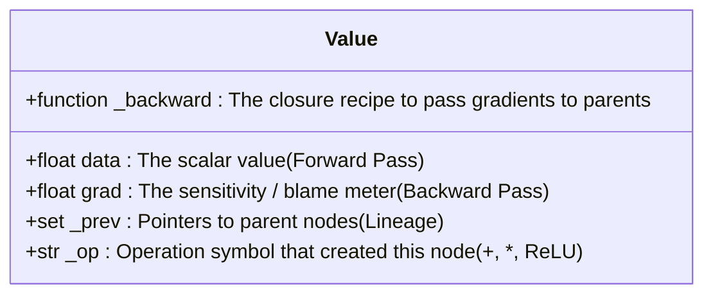
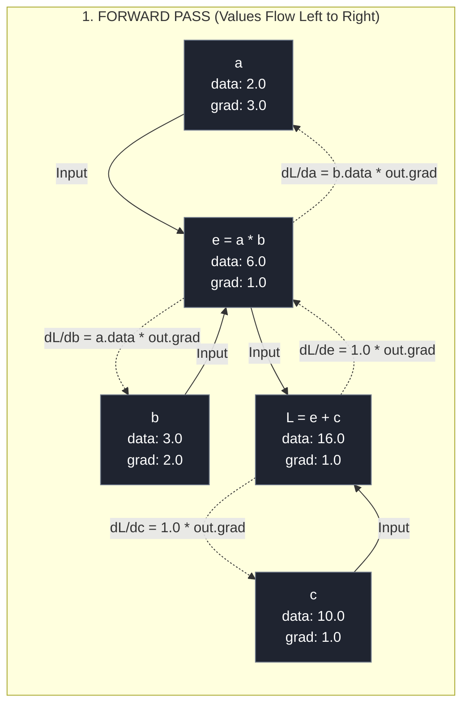
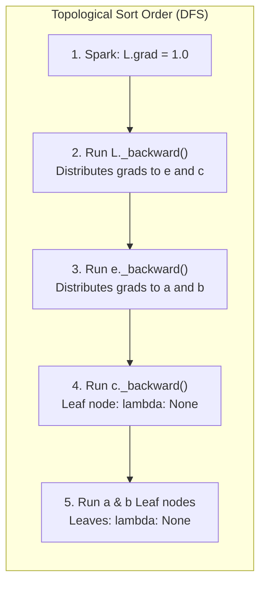
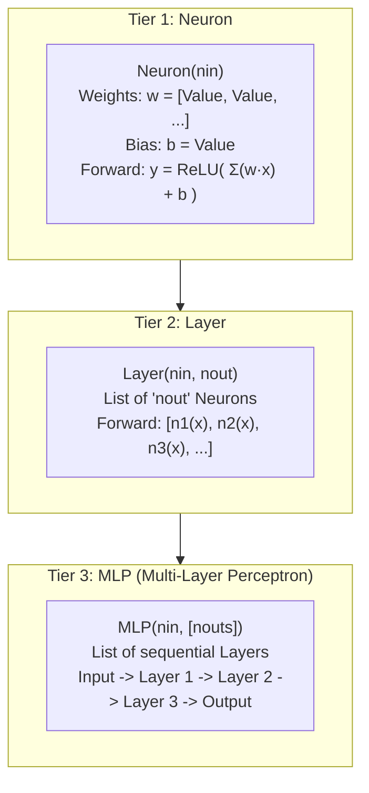
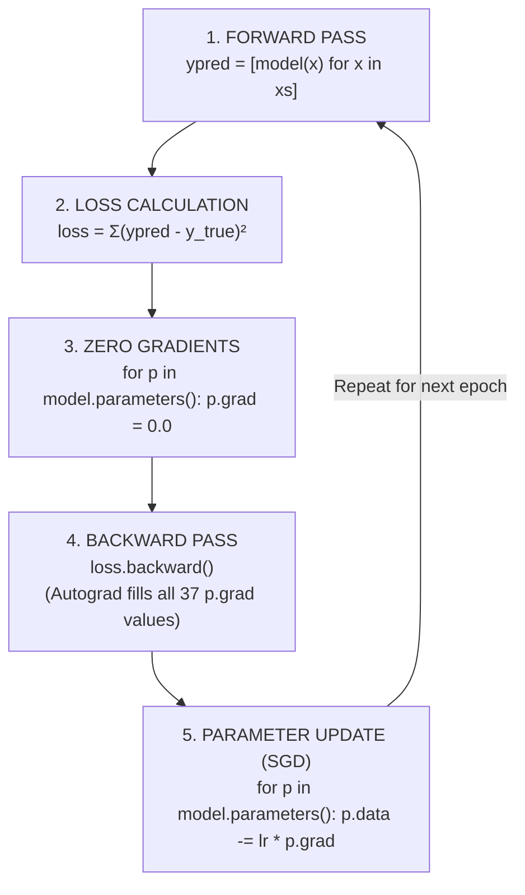

# Milestone 2: Master Visual Guide & Architecture Blueprint
## The Automatic Differentiation Engine & Object-Oriented Neural Network

---

## 1. Anatomy of the `Value` Node

Every scalar number in our autograd engine is wrapped inside a `Value` object. Inside computer memory, a `Value` node has 5 distinct internal compartments:



### Visual Representation of a Single Node:
```text
+-------------------------------------------------------+
|                      Value Node                       |
+-------------------------------------------------------+
|  data: 5.0                |  grad: 2.0                |
+---------------------------+---------------------------+
|  _op: "*"                 |  _prev: { a, b }          |
+-------------------------------------------------------+
|  _backward: <function _backward at 0x...>             |
|  "Take out.grad, multiply by local derivative,        |
|   and accumulate into self.grad and other.grad"       |
+-------------------------------------------------------+
```

---

## 2. The Computational Graph (DAG) & Gradient Flow

When you write mathematical equations with `Value` objects, Python builds a **Directed Acyclic Graph (DAG)** in real-time.

Take the equation:
$$e = a \times b$$
$$L = e + c$$



> **Legend**:
> - **Solid Lines ($\longrightarrow$)**: Forward pass computing `data` from inputs to loss.
> - **Dotted Lines ($-\cdot \rightarrow$)**: Backward pass flowing `grad` from loss to inputs via the Chain Rule.

---

## 3. The Local Derivative Ledger

Each mathematical gate knows its own local derivative rule. During backpropagation, it multiplies its incoming gradient (`out.grad`) by its local slope:

| Operation | Forward Math | Code Implementation | Local Derivative Formula | Backward Closure (`_backward`) |
| :--- | :--- | :--- | :--- | :--- |
| **Addition** | $c = a + b$ | `a + b` | $\frac{\partial c}{\partial a} = 1.0, \quad \frac{\partial c}{\partial b} = 1.0$ | `self.grad += 1.0 * out.grad`<br>`other.grad += 1.0 * out.grad` |
| **Multiplication** | $d = a \cdot b$ | `a * b` | $\frac{\partial d}{\partial a} = b, \quad \frac{\partial d}{\partial b} = a$ | `self.grad += other.data * out.grad`<br>`other.grad += self.data * out.grad` |
| **Negation** | $y = -x$ | `-self` | $\frac{\partial y}{\partial x} = -1.0$ | Expressed as `self * -1` |
| **Subtraction** | $y = a - b$ | `a - b` | $\frac{\partial y}{\partial a} = 1.0, \quad \frac{\partial y}{\partial b} = -1.0$ | Expressed as `self + (-other)` |
| **Power** | $y = x^k$ | `x ** k` | $\frac{\partial y}{\partial x} = k \cdot x^{k-1}$ | `self.grad += (k * self.data**(k-1)) * out.grad` |
| **Division** | $y = a / b$ | `a / b` | $\frac{\partial y}{\partial a} = \frac{1}{b}, \quad \frac{\partial y}{\partial b} = -\frac{a}{b^2}$ | Expressed as `self * (other ** -1)` |
| **ReLU** | $y = \max(0, x)$ | `x.relu()` | $\frac{\partial y}{\partial x} = 1.0 \text{ if } x > 0 \text{ else } 0.0$ | `self.grad += (out.data > 0) * out.grad` |

---

## 4. The Backpack Concept (Python Closures Demystified)

When an operation creates an `out` node, the backward pass cannot be calculated immediately because `out.grad` is not known yet. 

Instead, the operation packs an **un-called function** into `out._backward`:

```text
Forward Pass: c = a + b
========================================================================
1. Calculate output number: c.data = 7.0
2. Tag parents: c._prev = {a, b}
3. Pack the Backpack:
   c._backward = def _backward():
                     a.grad += 1.0 * c.grad
                     b.grad += 1.0 * c.grad
   (Note: NO PARENTHESES! The recipe is stored, not executed!)
========================================================================

Backward Pass: c._backward() is triggered later
========================================================================
1. c.grad has arrived from the boss (e.g. c.grad = 3.0)
2. Open backpack and run the recipe:
   a.grad += 1.0 * 3.0  --> a.grad becomes 3.0
   b.grad += 1.0 * 3.0  --> b.grad becomes 3.0
========================================================================
```

---

## 5. Topological Sort (Why Execution Order Matters)

In a computational graph, calling backward functions in arbitrary order leads to completely wrong gradients because downstream nodes have not yet delivered their gradients to upstream nodes.

### The Topological Ordering Rule:
> **No node can execute its `_backward()` until every child that depends on it has already finished executing!**



### Depth-First Search Algorithm:
```python
topo = []
visited = set()

def build_topo(v):
    if v not in visited:
        visited.add(v)
        for child in v._prev:
            build_topo(child)   # Recurse all the way to root inputs first
        topo.append(v)          # Append node only after all parents are visited

build_topo(loss)
# topo is now: [a, b, e, c, L]
# reversed(topo) is: [L, c, e, b, a]  <-- The exact reverse dependency order!
```

---

## 6. The 3-Tier Neural Network Architecture

Our neural network is built with three clean, object-oriented abstractions:



### The 37-Parameter Breakdown: `MLP(2, [4, 4, 1])`
- **Layer 1** (`Layer(2, 4)`):
  - 4 neurons, each with 2 weights + 1 bias = $4 \times 3 = \mathbf{12 \text{ parameters}}$
- **Layer 2** (`Layer(4, 4)`):
  - 4 neurons, each with 4 weights + 1 bias = $4 \times 5 = \mathbf{20 \text{ parameters}}$
- **Layer 3** (`Layer(4, 1)`):
  - 1 neuron, with 4 weights + 1 bias = $1 \times 5 = \mathbf{5 \text{ parameters}}$
- **Total Tunable Parameters:** $12 + 20 + 5 = \mathbf{37 \text{ parameters}}$

---

## 7. The Universal 5-Step Training Loop

Every modern deep learning training step follows this exact cyclic process:



### Why "Zero Grad" is Mandatory:
Because gradients accumulate via `self.grad += ...`, if you do not reset `p.grad = 0.0` at the start of each epoch, the new gradients will pile on top of old gradients from previous rounds, causing the optimization steps to explode violently!
