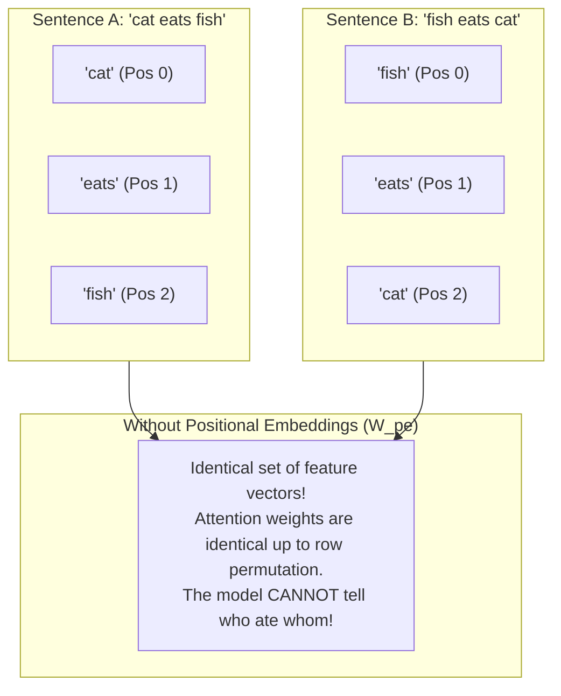
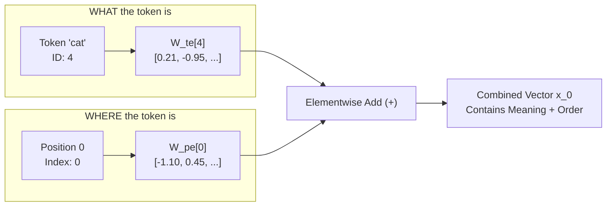

# Lab 1: Visual Deconstruction & Master Reference
## The Positional Blindspot, Permutation Invariance, and Sequence Order

---

## 0. The Problem: Self-Attention is a Bag-of-Words

Standard neural networks (like MLPs or CNNs) process inputs at fixed coordinates or spatial grids. 

In contrast, **Self-Attention** compares all pairs of tokens simultaneously via dot products:
$$\text{Attention}(Q, K, V) = \text{softmax}\left(\frac{Q K^T}{\sqrt{d_k}}\right) V$$

If you shuffle the input tokens, the dot products shuffle by the exact same permutation. **Self-Attention is strictly permutation-equivariant**:

---

## 1. Mathematical Proof of Permutation Invariance

Let $X = [\mathbf{x}_1, \dots, \mathbf{x}_T]^T \in \mathbb{R}^{T \times D}$ be the matrix of token embeddings. 
Let $P \in \{0, 1\}^{T \times T}$ be any permutation matrix (which reorders the rows of $X$).

When we permute the input:
$$\tilde{X} = P X$$

The projected Queries and Keys become:
$$\tilde{Q} = \tilde{X} W_q = P X W_q = P Q$$
$$\tilde{K} = \tilde{X} W_k = P X W_k = P K$$

Now calculate the attention scores:
$$\tilde{S} = \tilde{Q} \tilde{K}^T = (P Q) (P K)^T = P Q K^T P^T = P S P^T$$

And the attention output:
$$\tilde{O} = \text{softmax}(\tilde{S}) \tilde{V} = (P A P^T)(P V) = P (A V) = P O$$

### The Core Takeaway:
**The output vectors for `"cat"` and `"fish"` are identical regardless of their position in the sentence!** 
The model has **zero understanding of grammar, syntax, or direction** without an explicit positional signal.

---

## 2. The Solution: Learned Positional Embeddings ($W_{pe}$)

To break the symmetry, we introduce a dedicated position table:
$$W_{pe} \in \mathbb{R}^{T_{\text{max}} \times D}$$

Where each position index $t \in \{0, 1, \dots, T-1\}$ has a unique $D$-dimensional vector $\mathbf{p}_t = W_{pe}[t]$.

$$\mathbf{x}_t = \mathbf{w}_{te}[\text{token}_t] + W_{pe}[t]$$

---

## 3. Experimental Architecture for Lab 1

In `Lab1M3_scratch.py`, we run two controlled experiments:

1. **Experiment 1 (The Blindspot Proof)**:
   - Input A: `"hello"`
   - Input B: `"olleh"` (reversed)
   - Compute token embeddings only ($W_{te}$).
   - Show that the individual vectors for `'h'`, `'e'`, `'l'`, `'o'` in both strings have Euclidean distance **$0.0$**—they cannot represent context order.

2. **Experiment 2 (The Positional Injection)**:
   - Add positional embeddings ($W_{pe}$).
   - Measure the Euclidean distance between `'h'` at position 0 (in `"hello"`) versus `'h'` at position 4 (in `"olleh"`).
   - Prove that the distance is strictly non-zero:
     $$\text{Distance} = \|\mathbf{x}_{\text{'h', pos 0}} - \mathbf{x}_{\text{'h', pos 4}}\|_2 > 0$$
   - Calculate Attention with and without $W_{pe}$ and observe how attention distributions change.
