# Lab 2: Visual Deconstruction & Master Reference
## The Signal Explosion Trap, Variance Dynamics, and RMSNorm vs LayerNorm

---

## 0. The Problem: The Exponential Variance Explosion

In deep neural networks (like a 32-layer Llama model), activations pass through dozens of consecutive matrix multiplications:
$$\mathbf{x}_{l+1} = \mathbf{x}_l W_l$$

If $W \sim \mathcal{N}(0, 1)$ and $\mathbf{x} \in \mathbb{R}^D$ has variance $\sigma^2_x = 1.0$, the variance of each element in the output is:
$$\text{Var}((\mathbf{x} W)_j) = \text{Var}\left(\sum_{i=1}^D x_i W_{i,j}\right) = \sum_{i=1}^D \text{Var}(x_i) \text{Var}(W_{i,j}) = D \cdot \sigma^2_x \cdot \sigma^2_W$$

With $D = 16$:
- Layer 1: Magnitude $\approx 4$
- Layer 2: Magnitude $\approx 16$
- Layer 5: Magnitude $\approx 1,024$
- Layer 10: Magnitude $\approx 1,048,576$ ($> 10^6$!)

```mermaid
flowchart TD
    subgraph WithoutNorm ["Without Normalization (Exponential Explosion)"]
        X0["x_0 (Magnitude: ~1.0)"] --> L1["Layer 1 (@ W_1)"]
        L1 --> X1["x_1 (Magnitude: ~4.0)"]
        X1 --> L5["Layer 5 (@ W_5)"]
        L5 --> X5["x_5 (Magnitude: ~1,000)"]
        X5 --> L10["Layer 10 (@ W_10)"]
        L10 --> Boom["x_10 (Magnitude: > 1,000,000!)<br/>EXPLODING GRADIENTS / NaN"]
    end

    subgraph WithRMSNorm ["With RMSNorm (Clamped Stability)"]
        R0["x_0 (Magnitude: ~1.0)"] --> N1["RMSNorm"]
        N1 --> M1["Layer 1 (@ W_1)"]
        M1 --> N2["RMSNorm"]
        N2 --> Stable["x_10 (Magnitude: ~1.000)<br/>STABLE TRAINING FOREVER"]
    end
```

---

## 1. RMSNorm vs Classic LayerNorm: The Mathematical Difference

### Classic LayerNorm (Ba et al., 2016):
Calculates **both** the mean $\mu$ and the variance $\sigma^2$:
$$\mu = \frac{1}{D} \sum_{i=1}^D x_i, \quad \sigma^2 = \frac{1}{D} \sum_{i=1}^D (x_i - \mu)^2$$
$$\text{LayerNorm}(x) = \frac{x - \mu}{\sqrt{\sigma^2 + \epsilon}} \odot \gamma + \beta$$
*Requires: 2 statistical reductions (mean + variance), subtraction, division, multiplication, and addition.*

### Modern RMSNorm (Zhang & Sennrich, 2019):
Discovered that **mean-centering ($\mu$) does not contribute to training stability**; all the stabilizing power comes from scaling by the root-mean-square:
$$\text{RMS}(x) = \sqrt{\frac{1}{D} \sum_{i=1}^D x_i^2 + \epsilon}$$
$$\text{RMSNorm}(x) = \frac{x}{\text{RMS}(x)} \odot \gamma$$
*Requires: 1 statistical reduction, no mean-centering, no bias ($\beta$), and runs 20% to 50% faster on modern GPUs!*

```mermaid
graph TD
    subgraph LayerNormComputation ["Classic LayerNorm (Expensive)"]
        X1["Input x"] --> Mean["1. Compute Mean μ"]
        Mean --> Sub["2. Center: x - μ"]
        Sub --> Var["3. Compute Variance σ²"]
        Var --> Div1["4. Divide by sqrt(σ² + ε)"]
        Div1 --> Affine1["5. Scale (γ) and Shift (β)"]
    end

    subgraph RMSNormComputation ["Modern RMSNorm (Lean & Fast)"]
        X2["Input x"] --> Square["1. Square: x²"]
        Square --> Mean2["2. Mean of squares"]
        Mean2 --> Sqrt2["3. sqrt(mean + ε)"]
        Sqrt2 --> Div2["4. Divide: x / RMS(x)"]
        Div2 --> Affine2["5. Scale (γ) only!"]
    end
```

---

## 2. Experimental Architecture for Lab 2

In `Lab2M3ml_scratch.py`:
1. **Experiment 1 (The Uncontrolled Deep Network)**:
   - Pass an input vector through 10 sequential random matrix layers without normalization.
   - Record the root-mean-square magnitude and standard deviation at each layer.
   - Observe the exponential explosion ($1.0 \to 10^6$).
2. **Experiment 2 (The RMSNorm Governor)**:
   - Pass the same input through 10 layers, applying `rms_norm` after each matrix multiplication.
   - Measure the magnitude at each layer: prove it remains strictly clamped to $\approx 1.000$.
3. **Experiment 3 (RMSNorm vs LayerNorm Benchmark)**:
   - Implement both functions.
   - Compare their output numerical behavior and computational operations.
