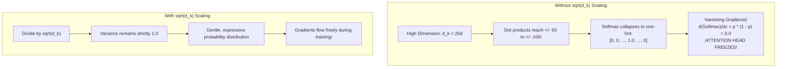

# Lab 3: Visual Deconstruction & Master Reference
## The Causal Mask, Future Cheating, and the $\sqrt{d_k}$ Scaling Trap

---

## 1. Overview: The Two Fatal Failure Modes of Attention

Self-Attention computes the interaction between all token pairs:
$$\text{Attention}(Q, K, V) = \text{softmax}\left(\frac{Q K^T}{\sqrt{d_k}} + M\right) V$$

In this lab, we isolate and stress-test two mathematical mechanisms that prevent catastrophic failures:
1. **The Causal Mask ($M$)**: Prevents future information leakage in autoregressive generation.
2. **The Dimension Scaler ($\sqrt{d_k}$)**: Prevents Softmax entropy collapse and vanishing gradients in high-dimensional latent spaces.

---

## 2. Experiment 1: The Future Cheating Trap (Unmasked vs Masked)

In an autoregressive Large Language Model, tokens are generated one at a time. Token $t$ must predict token $t+1$ based **only** on tokens $0 \dots t$.

```mermaid
flowchart TD
    subgraph Unmasked ["Case A: Unmasked Attention (BERT / Bidirectional)"]
        U0["Token 0: 'h'"] -->|Attends to ALL tokens!| Future["Token 4: 'o' (THE FUTURE)"]
        U_Note["CHEATING!<br/>The model doesn't learn language grammar;<br/>it simply copies the next character from the future!"]
    end

    subgraph CausalMasked ["Case B: Causal Masked Attention (LLaMA / GPT)"]
        M0["Token 0: 'h'"] -->|Sees only itself (100%)| M0
        M0 -.->|Upper Triangle = -inf| Blocked["Future BLOCKED (0.0% Attention)"]
        M_Note["HONEST GENERATION!<br/>Forces the model to predict the future<br/>from historical context alone."]
    end
```

### The Mathematics of $-\infty$:
$$M_{i,j} = \begin{cases} 0 & j \le i \\ -\infty & j > i \end{cases}$$

When exponentiated in Softmax:
$$\exp(-\infty) = 0.0$$

The future tokens receive **$0.0000\%$** attention probability, making future information mathematically non-existent.

---

## 3. Experiment 2: The $\sqrt{d_k}$ Scaling Trap (Entropy Collapse)

### Why do we divide by $\sqrt{d_k}$?
Let $\mathbf{q}, \mathbf{k} \in \mathbb{R}^{d_k}$ be random normal vectors with mean $0$ and variance $1$:
$$q_i \sim \mathcal{N}(0, 1), \quad k_i \sim \mathcal{N}(0, 1)$$

Their dot product is the sum of $d_k$ independent random variables:
$$z = \mathbf{q} \cdot \mathbf{k} = \sum_{i=1}^{d_k} q_i k_i$$

From probability theory:
$$\mathbb{E}[z] = 0, \quad \text{Var}(z) = d_k \cdot \text{Var}(q_i) \text{Var}(k_i) = d_k$$
$$\text{Standard Deviation} = \sqrt{\text{Var}(z)} = \mathbf{\sqrt{d_k}}$$

As dimension $d_k$ grows:
- If $d_k = 16 \implies \sigma = 4$
- If $d_k = 64 \implies \sigma = 8$
- If $d_k = 256 \implies \sigma = 16$
- If $d_k = 1024 \implies \sigma = 32$



### Softmax Derivative (Vanishing Gradient Proof):
$$\frac{\partial p_i}{\partial z_j} = p_i (\delta_{ij} - p_j)$$
When $p_i \to 1.0$ (or $0.0$), $p_i(1 - p_i) \to \mathbf{0.0}$. 
The gradient dies completely. Dividing by $\sqrt{d_k}$ preserves the gradient highway.
