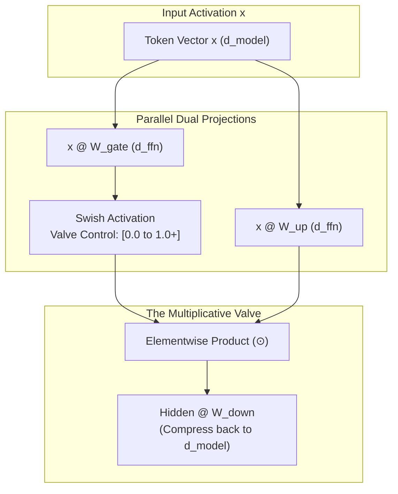
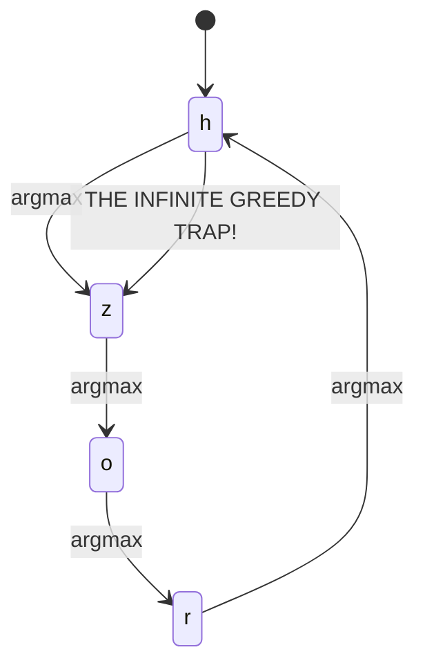
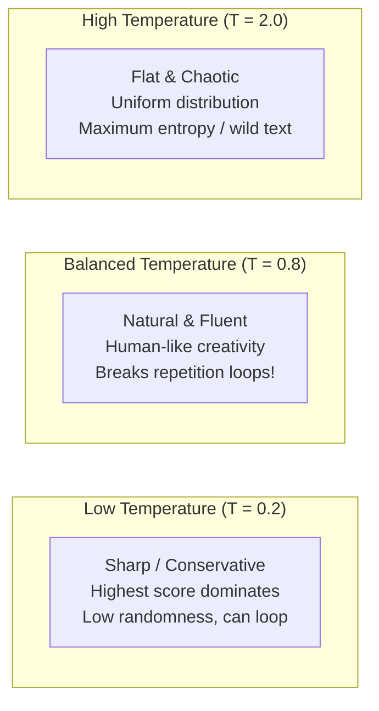

# Lab 4: Visual Deconstruction & Master Reference
## SwiGLU Dynamic Gating, The Repetition Trap, and Temperature Sampling

---

## 0. Overview: The Modern Computation and Decoding Architecture

In **Lab 4**, we stress-test the two mechanisms that govern how Transformers process features and speak text:
1. **The SwiGLU Gating Mechanism (Stage 5)**: Why modern frontier models (LLaMA 3, Gemma, Mistral) replaced standard ReLU/GELU with a 3-matrix multiplicative valve.
2. **The Generation Decoding Engine (Stage 7)**: Why greedy decoding (`argmax`) falls into periodic repetition loops (`hzorhzohzo`), and how **Temperature Sampling** restores diversity.

---

## 1. Experiment 1: The SwiGLU Valve (Feature Filtering)

In traditional MLPs, an activation function operates on a single linear projection:
$$\text{Output} = \text{ReLU}(x W_1) W_2$$

In **SwiGLU (Shazeer, 2020)**, the network computes two parallel projections:
1. **$x W_{\text{up}}$**: The content signal (what information might be transmitted).
2. **$x W_{\text{gate}}$**: The control signal (the valve that decides *how much* information gets transmitted).

$$\text{Swish}(z) = \frac{z}{1 + e^{-z}}$$
$$\text{SwiGLU}(x) = \Big( \text{Swish}(x W_{\text{gate}}) \odot (x W_{\text{up}}) \Big) W_{\text{down}}$$

### The Continuous Valve Behavior:
- When $z_{\text{gate}} \ll 0$ (e.g. $-5.0$): $\text{Swish}(z) \approx 0.0$ $\implies$ **Valve CLOSED** (feature silenced to 0).
- When $z_{\text{gate}} \gg 0$ (e.g. $+5.0$): $\text{Swish}(z) \approx z$ $\implies$ **Valve OPEN** (feature amplified and transmitted).

---

## 2. Experiment 2 & 3: The Greedy Repetition Trap vs Temperature

### Why did Milestone 3 loop `"hzorhzohzo"`?
With **Greedy Decoding** (`next_id = np.argmax(probs)`):
The model always picks the single token with the highest probability ($T \to 0$).
If state $A \to B \to C \to D \to A$, the model is permanently trapped in an infinite periodic loop!

---

## 3. The Solution: Temperature-Scaled Multinomial Sampling

Instead of picking the absolute maximum, we sample from the probability distribution using **Temperature ($T$)**:
$$P(y_i) = \frac{\exp(z_i / T)}{\sum_j \exp(z_j / T)}$$

### Sampling in NumPy:
Rather than `np.argmax(probs)`, we use:
$$\text{next\_id} = \text{np.random.choice}(\text{vocab\_size}, p=\text{probs})$$
This allows the model to explore alternate paths, instantly breaking cyclic loops.
