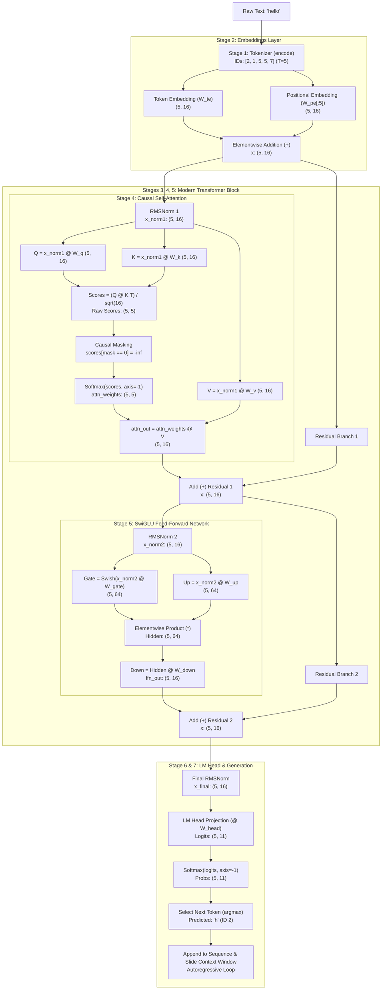

# Milestone 3: The Complete Transformer & Large Language Model (LLM) Architecture
*Mathematical & Architectural First-Principles Deconstruction*

---

## 1. Executive Summary & Architecture Blueprint

In **Milestone 3**, we constructed a complete, modern autoregressive Large Language Model (LLM) architecture from scratch using pure NumPy and mathematical first principles. The design incorporates the state-of-the-art architectural advancements powering frontier open-weight models such as **Llama 3, Gemma, and Mistral**:

1. **Character-Level Tokenizer**: Bidirectional string $\leftrightarrow$ integer token mapping ($V = 11$).
2. **Dual Embedding Layer**: Token Embeddings ($W_{te} \in \mathbb{R}^{V \times D}$) + Learnable Positional Embeddings ($W_{pe} \in \mathbb{R}^{T_{\text{max}} \times D}$).
3. **RMSNorm (Root Mean Square Normalization)**: Mean-free variance stabilization before Attention and FFN blocks.
4. **Causal Multi-Head Self-Attention (Single-Head Form)**: $Q, K, V$ projections with scaled dot-product affinity and lower-triangular causal masking ($-\infty$).
5. **Residual Connections (The $+1.0$ Gradient Highway)**: Additive skip connections preserving token identity and gradient backpropagation.
6. **SwiGLU Feed-Forward Network (FFN)**: 3-matrix gated linear unit with Swish (SiLU) activation.
7. **Language Model Head & Autoregressive Decoding Loop**: Final normalization, vocabulary logit projection, and recursive next-token generation with a sliding context window.

---

## 2. End-to-End Architectural Dataflow Diagram

---

## 3. Mathematical Specifications by Stage

### Stage 1: The Tokenizer
Transforms discrete characters $c \in \Sigma$ into integers $\{0, \dots, V-1\}$:
- Text: `"hello tokenizer"`
- Alphabet: `[' ', 'e', 'h', 'i', 'k', 'l', 'n', 'o', 'r', 't', 'z']` ($V = 11$)
- Encoding: $s \mapsto [s_0, s_1, \dots, s_{T-1}]$ where $s_t = \text{stoi}[c_t]$
- Decoding: $[i_0, i_1, \dots, i_{T-1}] \mapsto \text{"".join}(\text{itos}[i_t])$

### Stage 2: Dual Embeddings
Converts discrete token IDs into continuous $D$-dimensional vector spaces and injects sequence order:
- **Token Embedding**: $E_{\text{tok}} = W_{te}[\text{tokens}] \in \mathbb{R}^{T \times D}$
- **Positional Embedding**: $E_{\text{pos}} = W_{pe}[:T] \in \mathbb{R}^{T \times D}$
- **Combined Representation**:
  $$x = E_{\text{tok}} + E_{\text{pos}} \in \mathbb{R}^{T \times D}$$
  *Empirical Proof: Before positional embeddings, identical tokens (e.g. `'l'` at positions 2 and 3) had identical rows. Adding $W_{pe}$ broke the symmetry, enabling order sensitivity.*

### Stage 3: Root Mean Square Normalization (RMSNorm)
Modern alternative to LayerNorm that eliminates mean centering to reduce computational overhead:
$$\text{RMS}(x) = \sqrt{\frac{1}{D} \sum_{i=1}^D x_i^2 + \epsilon}$$
$$\text{RMSNorm}(x) = \left( \frac{x}{\text{RMS}(x)} \right) \odot \gamma$$
where $\gamma \in \mathbb{R}^D$ is a learnable gain vector initialized to $\mathbf{1}$, and $\epsilon = 10^{-5}$.

### Stage 4: Causal Self-Attention
Enables communication across positions while strictly preserving autoregressive causality:
1. **Projections**:
   $$Q = x_{\text{norm}} W_q, \quad K = x_{\text{norm}} W_k, \quad V = x_{\text{norm}} W_v \quad (W_q, W_k, W_v \in \mathbb{R}^{D \times D})$$
2. **Scaled Affinity Scores**:
   $$S = \frac{Q K^T}{\sqrt{d_k}} \in \mathbb{R}^{T \times T}$$
3. **Causal Masking**:
   $$M_{i,j} = \begin{cases} 0 & j \le i \\ -\infty & j > i \end{cases}, \quad S_{\text{masked}} = S + M$$
4. **Attention Weights**:
   $$A = \text{softmax}(S_{\text{masked}}, \text{axis}=-1) \implies \sum_{j=1}^T A_{i,j} = 1.0$$
5. **Contextual Aggregation**:
   $$\text{attn\_out} = A V \in \mathbb{R}^{T \times D}$$

### Stage 5: SwiGLU Feed-Forward Network
3-matrix non-linear gating replacing standard GELU/ReLU FFNs:
$$\text{Swish}(z) = z \cdot \sigma(z) = \frac{z}{1 + e^{-z}}$$
$$\text{SwiGLU}(x) = \Big( \text{Swish}(x_{\text{norm2}} W_{\text{gate}}) \odot (x_{\text{norm2}} W_{\text{up}}) \Big) W_{\text{down}}$$
where $W_{\text{gate}}, W_{\text{up}} \in \mathbb{R}^{D \times d_{\text{ffn}}}$, and $W_{\text{down}} \in \mathbb{R}^{d_{\text{ffn}} \times D}$ ($d_{\text{ffn}} = 64$).

### Stage 6: Language Model Head & Logits
Projects latent vectors back to vocabulary space:
$$x_{\text{final}} = \text{RMSNorm}(x, \gamma_{\text{final}})$$
$$\text{logits} = x_{\text{final}} W_{\text{head}} \in \mathbb{R}^{T \times V} \quad (W_{\text{head}} \in \mathbb{R}^{D \times V})$$
$$P(\text{next token} \mid \text{context}) = \text{softmax}(\text{logits}[-1])$$

### Stage 7: Autoregressive Text Generation Loop
For step $n \in \{1, \dots, N\}$:
1. Crop active token list: $\tau = \text{tokens}[-\text{block\_size}:]$
2. Forward pass: $p = \text{forward}(\tau)$
3. Sample / Argmax: $t_{\text{next}} = \arg\max_k p_k$
4. Append: $\text{tokens} \leftarrow \text{tokens} \cup [t_{\text{next}}]$
5. Decode and stream character: $\text{itos}[t_{\text{next}}]$

---

## 4. Tensor Shape Tracking Matrix

| Stage | Tensor Name | Mathematical Shape | Example Concrete Shape ($T=5, D=16, V=11, d_{\text{ffn}}=64$) |
|---|---|---|---|
| Input | `encoded` | $(T,)$ | $(5,)$ |
| Embedding | `token_embeddings` | $(T, D)$ | $(5, 16)$ |
| Embedding | `pos_embeddings` | $(T, D)$ | $(5, 16)$ |
| Combined | `x` | $(T, D)$ | $(5, 16)$ |
| RMSNorm 1 | `x_norm1` | $(T, D)$ | $(5, 16)$ |
| Attention | `Q, K, V` | $(T, D)$ | $(5, 16)$ |
| Attention | `scores` (Affinity) | $(T, T)$ | $(5, 5)$ |
| Attention | `attn_weights` | $(T, T)$ | $(5, 5)$ (Upper triangle = $0.0$) |
| Attention | `attn_out` | $(T, D)$ | $(5, 16)$ |
| Residual 1 | `x = x + attn_out` | $(T, D)$ | $(5, 16)$ |
| RMSNorm 2 | `x_norm2` | $(T, D)$ | $(5, 16)$ |
| SwiGLU | `gate, up` | $(T, d_{\text{ffn}})$ | $(5, 64)$ |
| SwiGLU | `hidden = gate * up` | $(T, d_{\text{ffn}})$ | $(5, 64)$ |
| SwiGLU | `ffn_out` | $(T, D)$ | $(5, 16)$ |
| Residual 2 | `x = x + ffn_out` | $(T, D)$ | $(5, 16)$ |
| Final Norm | `x_final` | $(T, D)$ | $(5, 16)$ |
| LM Head | `logits` | $(T, V)$ | $(5, 11)$ |
| Softmax | `probs` | $(T, V)$ | $(5, 11)$ (Row sums = $1.0$) |
| Prediction | `next_probs` | $(V,)$ | $(11,)$ |
