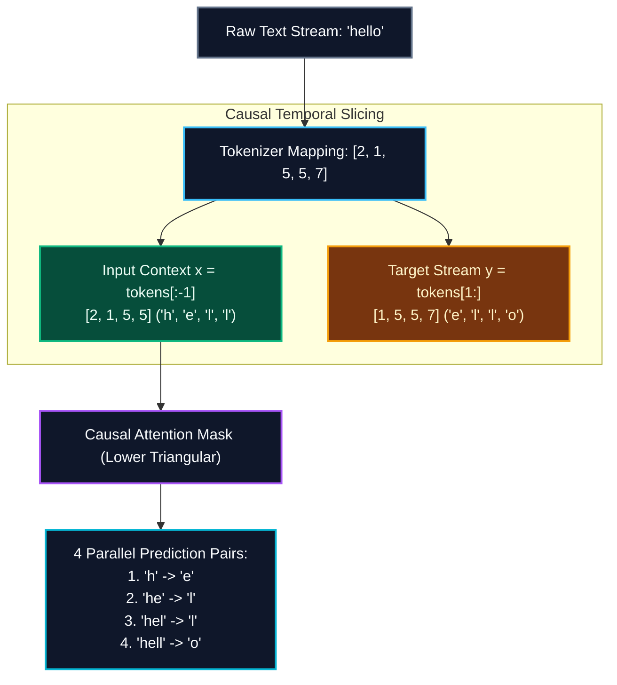
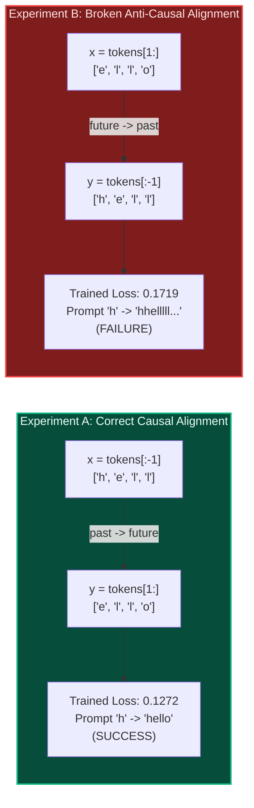
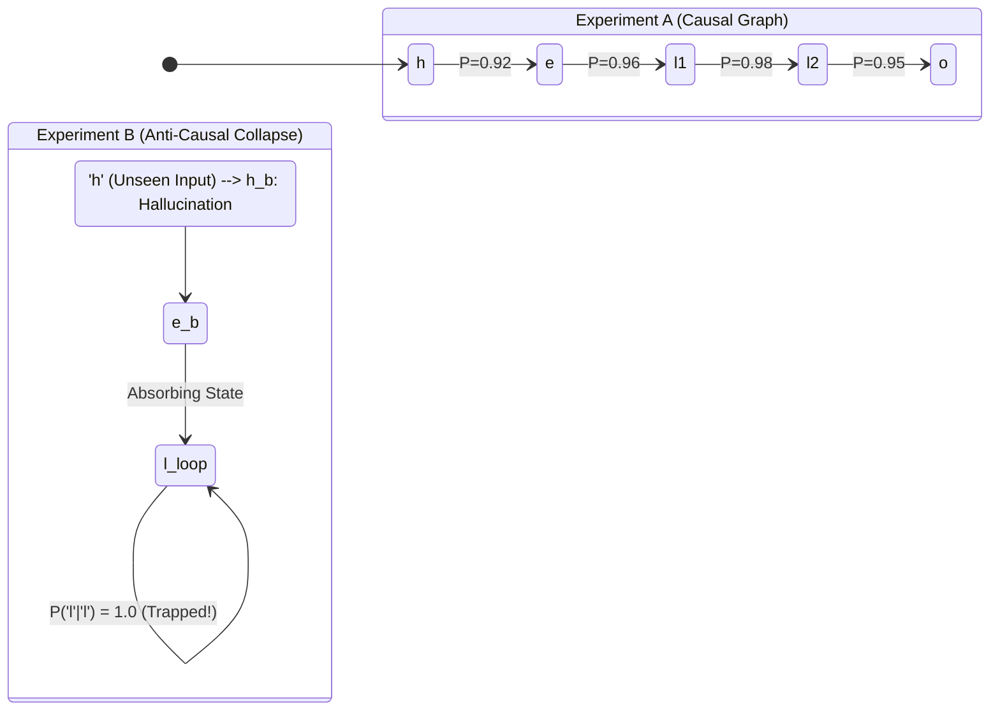

# Lab 1: Visual Deconstruction & Master Reference
## Causal Next-Token Slicing, Temporal Alignment, and Autoregressive Inference

---

## 1. The Problem: How Does an Unsupervised LLM Learn to Speak?

Raw text in nature does not come with labeled pairs like $(x = \text{image}, y = \text{cat})$. It is simply a continuous stream of characters or words: `"hello"`.

To convert raw unstructured text into a supervised learning machine, the Transformer applies **Causal Next-Token Slicing**:
- The model receives tokens up to time step $t$
- Its objective is to predict the token at time step $t+1$

---

## 2. Mathematical Formulation: The Autoregressive Chain Rule

Language modeling is framed as estimating the **joint probability distribution** of a sequence of tokens $W = (w_1, w_2, \dots, w_T)$.

Using the chain rule of probability:
$$P(w_1, w_2, \dots, w_T) = \prod_{t=1}^T P(w_t \mid w_1, w_2, \dots, w_{t-1})$$

In log-space, maximizing likelihood is equivalent to minimizing the negative log-likelihood (Cross-Entropy Loss):
$$\mathcal{L} = -\frac{1}{T} \sum_{t=1}^T \ln P(w_t \mid w_{<t})$$

### Why the Causal Mask is Essential
Without the lower-triangular causal attention mask ($\text{mask}_{ij} = 0 \text{ for } j > i$), token $t$ could look across the matrix directly into token $t+1$. 
The network would trivially learn to read the answer off the attention weights rather than learning language semantics!

---

## 3. Empirical Lab Results: Side-by-Side Comparison

In [`Lab1M4ml_scratch.py`](file:///c:/ProjectUltron/Milestone4Lab/Lab1M4ml_scratch.py), we trained two identical models from the exact same random initialization (`np.random.seed(42)`):

### Actual Training & Rollout Logs

| Metric / Stage | Experiment A (Correct Causal) | Experiment B (Anti-Causal Trap) | Mathematical Explanation |
| :--- | :---: | :---: | :--- |
| **Input $x$** | `['h', 'e', 'l', 'l']` | `['e', 'l', 'l', 'o']` | Sliced forwards vs backwards |
| **Target $y$** | `['e', 'l', 'l', 'o']` | `['h', 'e', 'l', 'l']` | Predict future vs predict past |
| **Initial Loss (Step 00)** | `1.4053` | `1.4035` | Both start with humble uncertainty |
| **Final Loss (Step 40)** | **`0.1272`** | **`0.1719`** | Both successfully minimize their training loss! |
| **Prompt** | `'h'` | `'h'` | Single-character seed |
| **Autoregressive Output** | **`hello`** | **`hhellllllllll...`** | **Exp A completes word; Exp B collapses into a loop!** |

---

## 4. Deep Dive: Why Did Experiment B Fail Despite Low Loss ($0.1719$)?

Notice that in Experiment B, the loss smoothly dropped to **`0.1719`**. The model **successfully learned its training objective**!

Why did it completely fail when asked to generate text?

### Failure Cause 1: The Out-of-Distribution Prompt Token
Look at the input tokens in Experiment B:
$$x_{\text{broken}} = \text{tokens}[1:] = [1, 5, 5, 7] \implies (e, l, l, o)$$

**Token `'h'` was NEVER an input during training!**
- The token embedding for `'h'` received **zero gradient updates** for its role as an initial input context.
- When prompted with `'h'` at inference time, the model encountered an input distribution it had literally never experienced during training.

### Failure Cause 2: Inverted Temporal Flow vs Forward Rollout
Autoregressive generation rollouts move **strictly forward in time**:
$$\text{Prompt } w_0 \to \text{Sample } w_1 \to \text{Sample } w_2 \to \dots$$

- Experiment A was trained to predict $w_{t+1}$ given $w_{\le t}$. Its training objective was **structurally identical to inference rollout**.
- Experiment B was trained to predict $w_{t-1}$ given $w_{\ge t}$ (reverse time). But at inference, the loop fed previous outputs back in forward time!
- Result: The transition matrix had no coherent path from `'h'`, fell into an absorbing Markov state at `'l'`, and repeated `'l'` forever.

---

## 5. Key Takeaways & Engineering Rules

> [!IMPORTANT]
> **Rule 1: Training Causality Must Mirror Inference Rollout**
> An autoregressive model can only generate sequences in the direction its causal attention mask and target labels were trained. Forward generation requires $x = \text{tokens}[:-1]$ and $y = \text{tokens}[1:]$.

> [!WARNING]
> **Rule 2: Low Training Loss Does Not Guarantee Generative Intelligence**
> A model can achieve near-zero loss on an inverted or degenerate task (like Experiment B's $0.1719$), yet fail completely during generation if the task formulation violates rollout causality.

> [!TIP]
> **Rule 3: Function Encapsulation & Global Parameter Scope**
> When wrapping training loops into reusable test functions (`run_experiment`), parameter updates (`W -= lr * dW`) treat weights as local variables unless declared `global`. Re-initializing weights inside the function with `np.random.seed(42)` ensures clean, fair benchmarks between experimental conditions.
