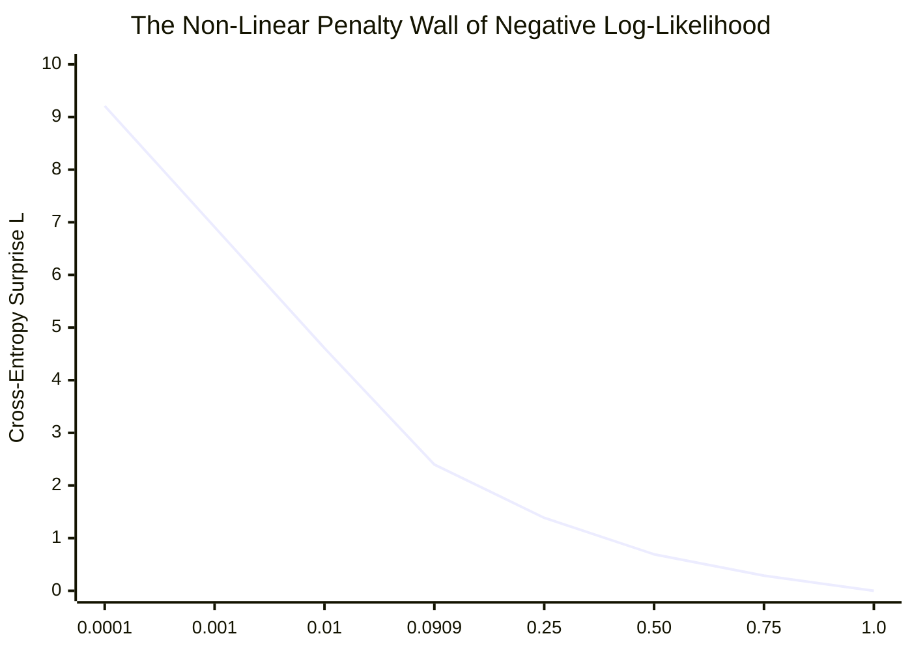

# Lab 2: Visual Deconstruction & Master Reference
## Cross-Entropy Surprise, Softmax Logit Spread, and the Humble Sanity Check

---

## 1. The Problem: The Overconfident Initialization Trap

When initializing neural networks, developers often use standard Gaussian noise:
$$W \sim \mathcal{N}(0, 1.0)$$

While this works for simple toy MLPs, applying standard normal weights to the **Language Model Head ($W_{\text{head}}$)** produces a catastrophic failure mode known as the **Overconfident Initialization Trap**:
- Large initial weights create large initial logit spreads (e.g. from $-8.94$ to $+6.35$).
- The Softmax exponential ($e^z$) violently magnifies this spread.
- The model makes wild, random guesses with **near 100% certainty on the wrong tokens**.
- The Cross-Entropy loss explodes to **`7.30`** (over $3\times$ higher than theoretical uncertainty).

```mermaid
flowchart TD
    subgraph NaiveInit ["Condition A: Unscaled Head (std = 1.0)"]
        W1["W_head ~ N(0, 1.0)"] --> L1["Wide Logits: [-8.94, +6.35]<br>Spread: 15.30"]
        L1 --> EXP1["Softmax e^z Amplification<br>Ratio: e^6.35 / e^-8.94 ≈ 4,600,000x"]
        EXP1 --> P1["Overconfident Probabilities:<br>P(correct) = 0.0009, 0.0000"]
        P1 --> LOSS1["Exploded Loss: 7.2976<br>(+4.90 higher than random guessing!)"]
    end

    subgraph ScaledInit ["Condition B: Humble Scaled Head (std = 0.01)"]
        W2["W_head ~ N(0, 0.01)"] --> L2["Flat Logits: [-0.089, +0.063]<br>Spread: 0.153"]
        L2 --> EXP2["Gentle Softmax Exponentials<br>Ratio ≈ 1.16x"]
        EXP2 --> P2["Humble Uniform Probabilities:<br>P(correct) ≈ 0.0900 ≈ 1/11"]
        P2 --> LOSS2["Theoretical Loss: 2.4079<br>(Matches ln(11) within 0.01!)"]
    end

    style NaiveInit fill:#7f1d1d,stroke:#ef4444,stroke-width:2px,color:#fee2e2
    style ScaledInit fill:#064e3b,stroke:#10b981,stroke-width:2px,color:#ecfdf5
```

---

## 2. Mathematical Proof: The Humble Baseline $\mathcal{L}_{\text{initial}} \equiv \ln(V)$

Let the vocabulary size be $V$. 

Before seeing any training data, an honest model should possess **maximum entropy (zero knowledge)**. Under maximum entropy, the probability distribution over all vocabulary tokens is strictly uniform:
$$P_i = \frac{1}{V}, \quad \forall i \in \{1, 2, \dots, V\}$$

The Cross-Entropy Loss for a target token $y$ is defined as:
$$\mathcal{L} = -\ln(P_y)$$

Substituting the uniform probability:
$$\mathcal{L}_{\text{initial}} = -\ln\left(\frac{1}{V}\right) = -(\ln(1) - \ln(V)) = \ln(V)$$

### The Sanity Benchmark for $V = 11$:
$$\ln(11) = 2.397895\dots \approx \mathbf{2.3979}$$

Any newly initialized language model that shows an initial loss significantly higher than $\ln(V)$ is **overconfidently wrong**, while any model with initial loss significantly lower is leaking target information.

---

## 3. Empirical Lab Results: Side-by-Side Comparison

In [`Lab2M4ml_scratch.py`](file:///c:/ProjectUltron/Milestone4Lab/Lab2M4ml_scratch.py), we evaluated the exact same backbone activations ($x_{\text{final}}$) against both initialization schemes:

| Measurement Metric | Condition A: Unscaled ($W_{\text{head}} \times 1.0$) | Condition B: Humble Scaled ($W_{\text{head}} \times 0.01$) | Mathematical Significance |
| :--- | :---: | :---: | :--- |
| **Logit Range** | `[-8.94, +6.35]` | `[-0.0894, +0.0635]` | $100\times$ narrower dynamic range |
| **Logit Dynamic Spread** | **`15.30`** | **`0.1530`** | Prevents exponential blowout |
| **$P(\text{correct tokens})$** | `[0.0055, 0.0009, 0.0074, 0.0000]` | `[0.0912, 0.0901, 0.0934, 0.0856]` | Random guess vs uniform distribution |
| **Mean $P(\text{correct})$** | `0.0035` ($0.35\%$) | **`0.0900`** ($9.00\%$) | Benchmark $\frac{1}{11} = 0.0909$ ($9.09\%$) |
| **Initial Loss ($\mathcal{L}$)** | **`7.2976`** | **`2.4079`** | **Drop of nearly 5.0 loss points!** |
| **Deviation from $\ln(11)$** | **`+4.8997`** (Massive Error) | **`0.0100`** (Near Zero) | **Humble sanity check satisfied!** |

---

## 4. Deep Dive: The Softmax Exponential & Logarithmic Surprise

Why does a logit spread of `15.30` cause such extreme devastation to the loss?

### 1. The Softmax Exponential Ratio
Softmax computes:
$$P_i = \frac{e^{z_i}}{\sum_j e^{z_j}}$$

The ratio of probabilities between the highest logit ($z_{\max} = 6.35$) and lowest logit ($z_{\min} = -8.94$) is:
$$\frac{e^{6.35}}{e^{-8.94}} = e^{6.35 - (-8.94)} = e^{15.29} \approx \mathbf{4,357,900}$$

The model is **4.3 million times more confident** in its favored random token than its least favored token!

### 2. The Asymptotic Surprise Wall
The Cross-Entropy Loss curve $-\ln(P)$ is non-linear. As probability approaches zero, the loss approaches infinity:

When Condition A assigned $P = 0.0009$ and $P = 0.0000$ to the target tokens, the loss hit the steep vertical wall of the logarithm:
- Position 1: $-\ln(0.0009) = \mathbf{7.01}$
- Position 3: $-\ln(0.00005) \approx \mathbf{9.90}$
- Average: **`7.2976`**

---

## 5. Why the Humble Initialization Stabilizes Training

Look at the gradient arriving at the logits:
$$\text{dlogits} = \frac{1}{T}(P - Y_{\text{one-hot}})$$

- In **Condition A**:
  Because $P$ is near $1.0$ for the wrong tokens and near $0.0$ for the correct token, $\text{dlogits}$ has massive values ($|d| \approx 1.0$).
  When multiplied by $x_{\text{final}}^T$, this generates enormous gradient vectors $\text{d}W_{\text{head}}$ that aggressively twist the model weights on step 0, frequently triggering numeric overflow.

- In **Condition B**:
  Because all $P_i \approx \frac{1}{11} \approx 0.09$, the error signal is smooth and gentle:
  $$\text{dlogits}_{\text{wrong}} \approx \frac{0.09 - 0}{4} = +0.0225$$
  $$\text{dlogits}_{\text{correct}} \approx \frac{0.09 - 1}{4} = -0.2275$$
  The gradients provide a clean, orderly directional signal that descends stably without shock.

---

## 6. Key Engineering Rules

> [!IMPORTANT]
> **Rule 1: The Legendary Sanity Check $\mathcal{L}_{\text{initial}} \approx \ln(V)$**
> On Step 0 of training any autoregressive Transformer, the initial cross-entropy loss must match $\ln(V)$ within $\pm 0.1$. If it is significantly higher, your LM Head weights are too large.

> [!TIP]
> **Rule 2: Scale $W_{\text{head}}$ to $\sigma \le 0.01$**
> Always initialize the Language Model Head with standard deviation $\sigma = 0.01$ (or $1/\sqrt{d_{\text{embed}}}$) to ensure flat logits, maximum entropy, and humble uniform starting uncertainty.
