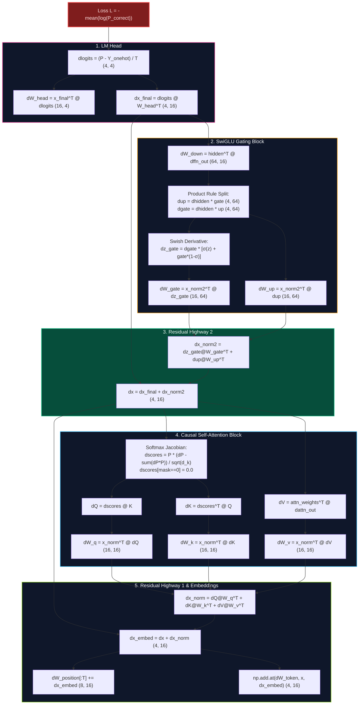

# Lab 3: Visual Deconstruction & Master Reference
## Matrix Calculus Symmetry, Reverse Topology, and the Duplicate Token Accumulation Trap

---

## 1. The Problem: The Invisible Gradient Destruction

A Transformer consists of 9 distinct parameter weight matrices spread across embeddings, attention projections, non-linear feedforward networks, and output heads.

When training from scratch in pure NumPy, two fatal engineering hazards exist:
1. **Dimension Mismatch**: If a transpose is flipped in any of the 9 matrix multiplications, dimensions fail to align, or worse, compute transposed gradients that silently destroy weight updates.
2. **The Duplicate Token Trap**: In natural language, words and characters repeat within the context window (e.g. `'l'` appears twice in `"hello"`: `[1, 0, 2, 2]`). Standard Python slice addition (`arr[x] += grad`) **silently overwrites earlier occurrences**, throwing away up to 50% of the training gradient!

```mermaid
flowchart TD
    subgraph NaiveTrap ["The Naive Slice Overwrite Trap (arr[x] += dx)"]
        N_IN["Input x: [1, 0, 2, 2]<br>Index 2 ('l') appears twice"]
        N_READ["Buffered Read: Reads W_token[2] once"]
        N_WRITE1["Writes Pos 2 Gradient to W_token[2]"]
        N_WRITE2["Writes Pos 3 Gradient to W_token[2]<br>(SILENTLY OVERWRITES POS 2!)"]
        N_RESULT["Result: Did naive slice overwrite pos 2? TRUE!<br>50% of learning signal destroyed!"]
        N_IN --> N_READ --> N_WRITE1 --> N_WRITE2 --> N_RESULT
    end

    subgraph AtomicFix ["The Atomic Accumulation Fix (np.add.at)"]
        A_IN["Input x: [1, 0, 2, 2]"]
        A_ACC["Unbuffered Atomic Accumulator:<br>W_token[2] = 0 + dx[2] + dx[3]"]
        A_RESULT["Result: 100% of gradient signal preserved!"]
        A_IN --> A_ACC --> A_RESULT
    end

    style NaiveTrap fill:#7f1d1d,stroke:#ef4444,stroke-width:2px,color:#fee2e2
    style AtomicFix fill:#064e3b,stroke:#10b981,stroke-width:2px,color:#ecfdf5
```



---

## 2. The 9-Gradient Matrix Topology (The Full Backward Map)

The backward pass reverses through every layer using the universal linear derivative rule:
$$\text{If } Y = X @ W \implies \mathbf{\text{d}W = X^T @ \text{d}Y}, \quad \mathbf{\text{d}X = \text{d}Y @ W^T}$$



---

## 3. Empirical Experiment 1: The 9-Gradient Shape Symmetry Table

From your actual execution of [`Lab3M4ml_scratch.py`](file:///c:/ProjectUltron/Milestone4Lab/Lab3M4ml_scratch.py):

| Parameter Tensor | Name / Location in Model | Forward Weight Shape | Backward Gradient Shape | Dimension Symmetry Match |
| :--- | :--- | :---: | :---: | :---: |
| **$W_{\text{head}}$** | Language Model Head Projection | `(16, 4)` | `(16, 4)` | **True $\checkmark$** |
| **$W_{\text{down}}$** | SwiGLU Down Projection | `(64, 16)` | `(64, 16)` | **True $\checkmark$** |
| **$W_{\text{up}}$** | SwiGLU Up Projection | `(16, 64)` | `(16, 64)` | **True $\checkmark$** |
| **$W_{\text{gate}}$** | SwiGLU Gate Projection | `(16, 64)` | `(16, 64)` | **True $\checkmark$** |
| **$W_q$** | Attention Query Projection | `(16, 16)` | `(16, 16)` | **True $\checkmark$** |
| **$W_k$** | Attention Key Projection | `(16, 16)` | `(16, 16)` | **True $\checkmark$** |
| **$W_v$** | Attention Value Projection | `(16, 16)` | `(16, 16)` | **True $\checkmark$** |
| **$W_{\text{position}}$** | Positional Embedding Matrix | `(8, 16)` | `(8, 16)` | **True $\checkmark$** |
| **$W_{\text{token}}$** | Token Embedding Matrix | `(4, 16)` | `(4, 16)` | **True $\checkmark$** |

Every single derivative tensor strictly conserves its parameter space.

---

## 4. Empirical Experiment 2: The Duplicate Token Accumulation Trap

### 1. The Setup
For the input context $x = \text{tokens}[:-1]$ from `"hello"`:
$$x = [1, 0, 2, 2] \implies ('h', 'e', 'l', 'l')$$
Notice that token index `2` (`'l'`) appears at **both position 2 and position 3**.

### 2. Empirical Measurement Logs

```text
----------------------------------------------------------------------------------------------------
EXPERIMENT 2: THE DUPLICATE TOKEN ACCUMULATION TRAP
----------------------------------------------------------------------------------------------------
Input x: [1, 0, 2, 2]
Token ID for 'l': 2 (appears at position 2 and position 3)

Naive dW_token['l'] norm (+=) :      0.0104
Correct dW_token['l'] norm (add.at): 0.0089
Did naive slice overwrite pos 2 with pos 3? True
```

### 3. Why Did Naive Slice Addition Fail?
In Python and NumPy:
```python
dW_token[x] += dx_embed
```
Under the hood, NumPy executes a **buffered evaluation**:
1. It reads `dW_token[2] = 0.0`
2. For position 2, it calculates `0.0 + dx_embed[2]`
3. For position 3, it **evaluates using the same initial buffer `0.0`**, calculating `0.0 + dx_embed[3]`
4. It writes back `dx_embed[3]` to index 2!

**Result:** `np.allclose(dW_token_naive[2], dx_embed[3]) == True`!
The gradient from position 2 was completely erased. Any token that repeats within a context window loses all earlier gradients.

### 4. The Fix: Unbuffered Atomic Accumulation
NumPy provides `np.add.at(target, indices, values)` specifically for this purpose:
```python
np.add.at(dW_token, x, dx_embed)
```
`np.add.at` performs an **unbuffered in-place atomic accumulation**, guaranteeing:
$$\text{d}W_{\text{token}}[2] = \text{d}x_{\text{embed}}[2] + \text{d}x_{\text{embed}}[3]$$

---

## 5. Key Takeaways & Engineering Rules

> [!IMPORTANT]
> **Rule 1: Always Use `np.add.at` for Token Embeddings**
> In natural language, stop words (`"the"`, `"and"`), punctuation, and subwords appear dozens of times per document. Using naive slice addition (`+=`) silences all occurrences except the last one. Always use `np.add.at` for embedding gradient accumulation.

> [!TIP]
> **Rule 2: Universal Linear Layer Transpose Rule**
> When backpropagating through any linear layer $Y = X @ W$:
> - The weight gradient is always: $\text{input}^T @ \text{incoming\_gradient}$
> - The input gradient is always: $\text{incoming\_gradient} @ \text{weight}^T$

> [!NOTE]
> **Rule 3: Residual Highway Superhighways**
> In forward, residual connections add signals: $x \leftarrow x + f(x)$. In backward, residual connections split incoming gradients equally across both pathways without attenuation: $\text{d}x = \text{d}x_{\text{skip}} + \text{d}x_{\text{branch}}$.
