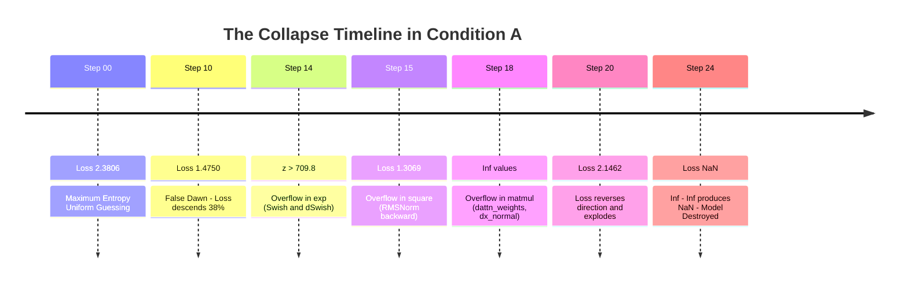

# Lab 4: Visual Deconstruction & Master Reference
## Training Dynamics, Multi-Layer Variance Compounding, and the Numerical Collapse Trap

---

## 0. The Problem: The Seductive "False Dawn" and Sudden Death

In deep neural networks, a model can appear to be training successfully for 10 or 15 iterations—loss steadily dropping—before suddenly detonating into `FloatingPointError` and producing `Loss: nan`.

This is the **Weight Explosion Collapse Trap**:
1. When weights have unit standard deviation ($\sigma = 1.0$), matrix multiplications amplify feature variance across every layer.
2. Non-linear gating (like SwiGLU's element-wise $\text{gate} \odot \text{up}$) squares intermediate magnitudes.
3. Once any activation exceeds $z > +709.78$, NumPy's 64-bit float limit is breached:
   $$e^{709.78} \approx 1.79 \times 10^{308} \implies e^{710} = \boldsymbol{\infty}$$
4. Once $\infty$ enters the forward activations, backpropagation multiplies $\infty$ by incoming gradients, producing:
   $$\infty - \infty = \mathbf{NaN}, \quad 0 \times \infty = \mathbf{NaN}$$
   The entire model suffers instant, irreversible brain death.

```mermaid
flowchart TD
    subgraph CollapseStages ["The 4 Stages of Numerical Collapse (Condition A: std = 1.0)"]
        S1["Stage 1: The False Dawn (Steps 0-10)<br>Loss drops: 2.38 -> 1.80 -> 1.47<br>(Developer thinks training is working!)"]
        S2["Stage 2: The Activation Breach (Step 14)<br>Pre-activations z exceed +709.8<br>RuntimeWarning: overflow in exp!"]
        S3["Stage 3: The Gradient Cascade (Steps 15-20)<br>overflow in square (RMSNorm)<br>overflow in matmul (dx_normal)<br>Loss reverses direction: 1.30 -> 2.14!"]
        S4["Stage 4: Total Brain Death (Step 24)<br>Loss = NaN (Not a Number)<br>All weights corrupted by NaNs!"]
        
        S1 --> S2 --> S3 --> S4
    end

    subgraph StableDescent ["The Stable Scale Fix (Condition B: std = 0.1)"]
        B1["Stage 1: Step 00 | Loss: 2.3898"]
        B2["Stage 2: Step 10 | Loss: 1.0968"]
        B3["Stage 3: Step 20 | Loss: 0.6835"]
        B4["Stage 4: Step 24 | Loss: 0.5839<br>(Smooth, bounded, zero warnings!)"]
        
        B1 --> B2 --> B3 --> B4
    end

    style CollapseStages fill:#7f1d1d,stroke:#ef4444,stroke-width:2px,color:#fee2e2
    style StableDescent fill:#064e3b,stroke:#10b981,stroke-width:2px,color:#ecfdf5
```



---

## 1. Mathematical Analysis: Why Variance Compounds Across Layers

Consider a linear matrix multiplication $y = x @ W$, where $x \in \mathbb{R}^{D_{\text{in}}}$ and $W \in \mathbb{R}^{D_{\text{in}} \times D_{\text{out}}}$.

Assuming independent zero-mean components:
$$\operatorname{Var}(y_j) = \sum_{i=1}^{D_{\text{in}}} \operatorname{Var}(x_i) \operatorname{Var}(W_{ij}) = D_{\text{in}} \cdot \operatorname{Var}(x) \cdot \operatorname{Var}(W)$$

### In Condition A (Unscaled: $\sigma = 1.0 \implies \operatorname{Var}(W) = 1.0$):
- Entering attention projection ($D_{\text{in}} = 16$):
  $$\operatorname{Var}(Q) = 16 \times 1.0 \times 1.0 = \mathbf{16}$$
- Entering SwiGLU up & gate projections ($D_{\text{in}} = 16$):
  $$\operatorname{Var}(\text{gate}) = 16 \times 1.0 \times 1.0 = \mathbf{16}$$
- SwiGLU product $\text{hidden} = \text{gate} \odot \text{up}$:
  $$\operatorname{Var}(\text{hidden}) \approx \operatorname{Var}(\text{gate}) \cdot \operatorname{Var}(\text{up}) = 16 \times 16 = \mathbf{256}$$
- SwiGLU down projection ($D_{\text{in}} = 64$):
  $$\operatorname{Var}(\text{ffn\_out}) = 64 \times 256 \times 1.0 = \mathbf{16,384}$$
- The signal added to the residual stream has a standard deviation of $\sqrt{16,384} = \mathbf{128}$!
- Within 14 training steps, weight updates compound this variance past $709$, triggering exponential overflow.

### In Condition B (Scaled: $\sigma = 0.1 \implies \operatorname{Var}(W) = 0.01$):
- Attention projection:
  $$\operatorname{Var}(Q) = 16 \times 1.0 \times 0.01 = \mathbf{0.16}$$
- SwiGLU projections:
  $$\operatorname{Var}(\text{gate}) = 16 \times 1.0 \times 0.01 = \mathbf{0.16}$$
- SwiGLU product:
  $$\operatorname{Var}(\text{hidden}) = 0.16 \times 0.16 = \mathbf{0.0256}$$
- SwiGLU down projection:
  $$\operatorname{Var}(\text{ffn\_out}) = 64 \times 0.0256 \times 0.01 = \mathbf{0.0164}$$
- The standard deviation added to the residual stream is only $\sqrt{0.0164} \approx \mathbf{0.128}$!
- The signal remains strictly bounded, never approaching the IEEE 754 overflow barrier.

---

## 2. Empirical Lab Results: Side-by-Side Comparison

From your actual run of [`Lab4M4ml_scratch.py`](file:///c:/ProjectUltron/Milestone4Lab/Lab4M4ml_scratch.py):

| Training Step | Condition A: Unscaled ($\sigma = 1.0$) | Condition B: Scaled ($\sigma = 0.1$) | Diagnostic State |
| :---: | :---: | :---: | :--- |
| **Step 00** | `2.3806` | `2.3898` | Both models start at humble random guessing ($\approx \ln(11)$) |
| **Step 05** | `1.8017` | `1.5921` | Both models begin descending |
| **Step 10** | `1.4750` | `1.0968` | Scaled model learns faster with cleaner gradients |
| **Step 14** | `overflow in exp (swish)` | *Zero warnings* | **Pre-activations breach the $+709.8$ overflow barrier!** |
| **Step 15** | `1.3069` (Corrupted) | `0.8448` | `overflow in square` in RMSNorm |
| **Step 20** | `2.1462` (Diverging!) | `0.6835` | **Loss reverses direction! Unstable gradient explosion** |
| **Step 24** | **`nan` (FATAL COLLAPSE)** | **`0.5839` (CONVERGING)** | **Condition A is dead; Condition B continues stably!** |

---

## 3. The Collapse Timeline: Anatomy of the Domino Effect



---

## 4. Key Takeaways & Engineering Rules

> [!CAUTION]
> **Rule 1: Decreasing Loss Does Not Guarantee Numerical Safety**
> Condition A showed decreasing loss for 14 straight steps (`2.38 -> 1.30`) before detonating. Always monitor activation magnitudes and pre-activation gradients, not just training loss.

> [!IMPORTANT]
> **Rule 2: Modern Transformer Weight Initialization ($\sigma \le 0.1$)**
> In deep Transformer architectures (like GPT, LLaMA, and Mistral), all linear layers ($W_q, W_k, W_v, W_{\text{gate}}, W_{\text{up}}, W_{\text{down}}$) must be initialized with standard deviation $\sigma \approx 0.02 - 0.1$ (or Xavier/He scaling $\sqrt{2 / D}$) to compensate for multi-layer variance accumulation.

> [!TIP]
> **Rule 3: Numerical Guardrails for Activations**
> When writing activation functions like Swish or Sigmoid in NumPy, safe production implementations clip pre-activations:
> ```python
> def swish(z):
>     return z / (1.0 + np.exp(-np.clip(z, -30.0, 30.0)))
> ```
> This prevents `np.exp` from ever encountering values that overflow IEEE 754 float limits.
