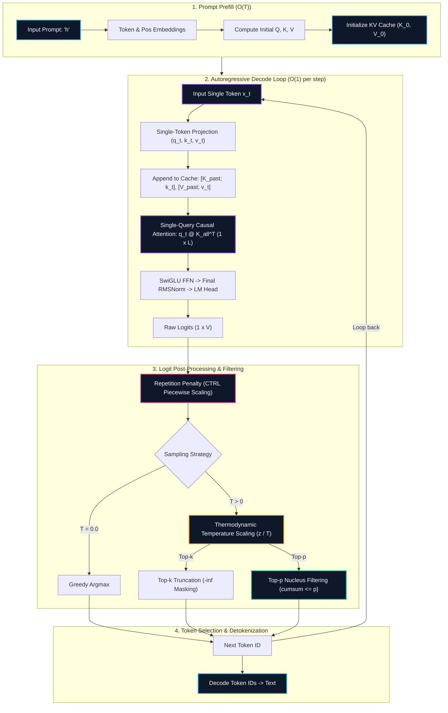
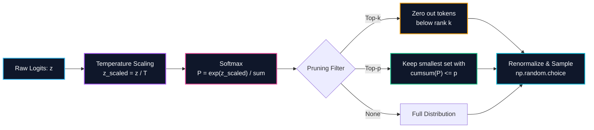
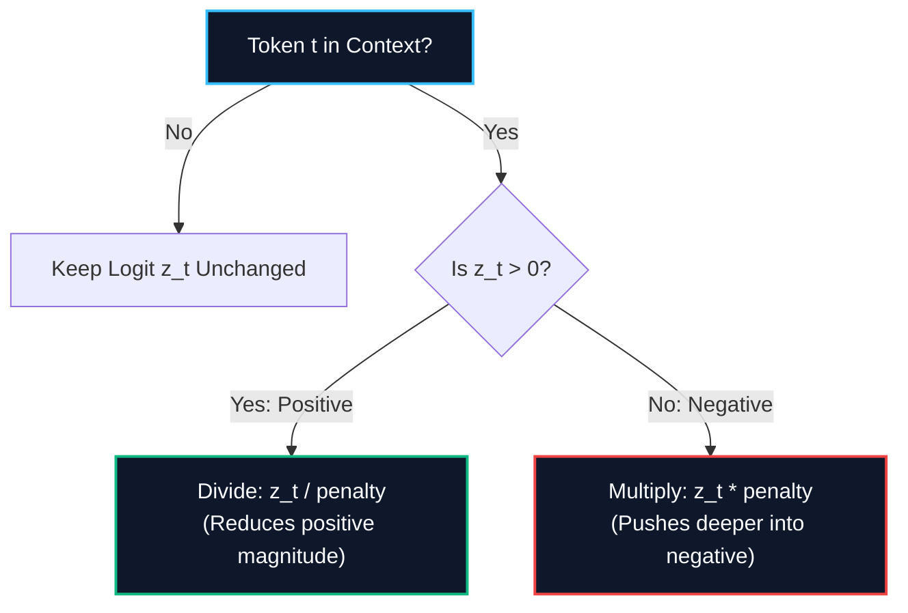
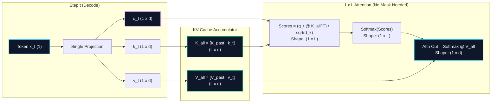
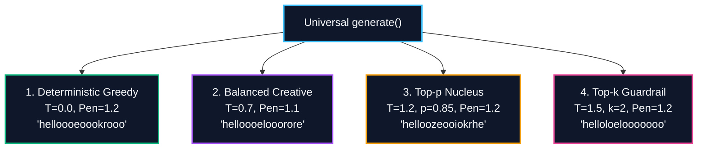

# Milestone 5 Master Visual Guide: Inference, Decoding Mechanics & The KV Cache

This visual guide provides the definitive mathematical, architectural, and empirical breakdown of **Milestone 5: Inference & Generation Mechanics**.

Having trained our Transformer in Milestone 4, Milestone 5 transforms it into a **high-performance, production-grade text generation engine**. We construct the 4 core pillars of modern LLM inference: **Thermodynamic Samplers**, **CTRL Repetition Penalties**, **The KV Cache Engine**, and a **Unified Generation Pipeline**.

---

## 1. High-Resolution Inference & KV Cache Infographic


> [!NOTE]
> The infographic above is rendered at 200 DPI and stored locally at [`core_componentsm5_visual_guide.png`](file:///c:/ProjectUltron/VisualRepresentation/Milestone5Visuals/core_componentsm5_visual_guide.png). It illustrates the four core dimensions of LLM inference: Thermodynamic Temperature Reshaping, Top-$k$ / Top-$p$ Nucleus Boundary Dynamics, the CTRL Sign-Aware Repetition Penalty, and the Quadratic Compute Collapse averted by the KV Cache.

---

## 2. The 4 Pillars of Modern LLM Inference



---

## 2. Pillar 1: Modern Sampling Strategies

Raw logits $z \in \mathbb{R}^V$ output by the LM head are unnormalized log-probabilities. How we turn logits into tokens determines whether the model outputs deterministic code, creative prose, or incoherent noise.



### 1. Greedy Decoding
- **Formula**: $\hat{t} = \arg\max_i (z_i)$
- **Characteristics**: $100\%$ deterministic. Always takes the path of maximum instantaneous likelihood.
- **Flaw**: Highly prone to degenerate loops (stuck in repetitive cycles).

### 2. Thermodynamic Temperature ($T$)
- **Formula**: 
  $$P_i = \frac{e^{z_i / T}}{\sum_{j=1}^V e^{z_j / T}}$$
- **Mathematical Limits**:
  - As $T \to 0$: Distribution approaches a Dirac delta centered on the argmax (Greedy).
  - At $T = 1.0$: True learned probability distribution.
  - As $T \to \infty$: Distribution approaches uniform noise ($\frac{1}{V}$).

### 3. Top-$k$ Truncation
- **Formula**: Keep only the top $k$ highest logit values; set all others to $-\infty$:
  $$z_i' = \begin{cases} z_i & \text{if } z_i \ge z_{(k)} \\ -\infty & \text{otherwise} \end{cases}$$
- **Role**: Provides a strict guardrail against long-tail catastrophic hallucinations, even at high temperatures.

### 4. Top-$p$ (Nucleus) Sampling
- **Formula**: Select the smallest subset of tokens $V^{(p)} \subset V$ such that their cumulative probability mass satisfies:
  $$\sum_{i \in V^{(p)}} P_{(i)} \ge p$$
- **Vectorized NumPy Trick**:
  ```python
  sorted_indices_to_remove = cumulative_probs - sorted_probs > p
  ```
  *(Guarantees the token crossing $p$ is included, and guarantees the #1 rank token is never pruned).*

### Empirical Sampler Benchmark from [`Chapters/Milestone5.py`](file:///C:/ProjectUltron/Chapters/Milestone5.py):

| Strategy | Parameters | Generated Text (from `'h'`) | Qualitative Behavior |
| :--- | :--- | :--- | :--- |
| **Low Temperature** | $T = 0.05$ | `'helloooeooooooooreooo'` | Razor-sharp, near-greedy, repeats dominant token |
| **Balanced Temperature**| $T = 0.70$ | `'helloooelooooookehelo'` | Natural balance between precision and diversity |
| **Chaotic Temperature** | $T = 3.00$ | `'heoooenroolo nellohoo'` | Completely disordered high-entropy noise |
| **Top-$k$ Shield** | $k=1, T=2.0$ | `'helloooeooooooooreooo'` | Top-1 acts as an impenetrable shield against $T=2.0$ |
| **Top-$k$ Shield** | $k=2, T=2.0$ | `'helloloeoooooorroreoo'` | Constrains high temp to top-2 candidate duel |
| **Top-$p$ Nucleus** | $p=0.40, T=2.0$ | `'helloloooorori eloooo'` | Restricts pool strictly to the high-probability core |
| **Top-$p$ Nucleus** | $p=0.95, T=2.0$ | `'hellnoolzooneorklkloo'` | Expands pool to admit rare characters like `'z'` |

---

## 3. Pillar 2: The Repetition Penalty (CTRL Formulation)

### The Degenerative Feedback Loop
Autoregressive generation naturally suffers from positive feedback loops: if `'o'` is predicted, the context now contains more `'o'`s. The model's transition probability $P('o' \mid \dots 'o')$ reinforces itself, leading to infinite stuttering (`'ooooooo'`).

### The Negative Logit Inversion Trap
A naive approach would divide all seen logits by a penalty $\theta = 1.2$:
$$\text{If } z_i = +4.0 \implies \frac{4.0}{1.2} = +3.33 \quad (\text{Decreased } \checkmark)$$
$$\text{If } z_i = -4.0 \implies \frac{-4.0}{1.2} = -3.33 \quad (\textbf{INCREASED! } \mathbf{-3.33 > -4.0} \implies \text{Fatal Bug!})$$

### The Exact Piecewise Formulation
To universally suppress probabilities for all tokens $t \in \text{context}$, we scale according to sign:

$$z_t \leftarrow \begin{cases} z_t / \theta & \text{if } z_t > 0 \\ z_t \cdot \theta & \text{if } z_t \le 0 \end{cases} \quad (\theta \ge 1.0)$$



### Empirical Impact on Decoding:
- **`Penalty = 1.0`**: Generates `'helloooeooooooooreooo'` (7 consecutive `'o'`s).
- **`Penalty = 1.2`**: Generates `'helloooeooooooroeoooo'` (Suppresses `'o'` to unlock `'r'` earlier).

---

## 4. Pillar 3: The KV Cache Engine ($O(T^2) \to O(T)$)

### The Inefficiency of Naive Autoregressive Generation
In standard `forward(context)`, at each generation step $t$, the model recomputes $Q_0 \dots Q_t$, $K_0 \dots K_t$, and $V_0 \dots V_t$ across all previous tokens.

$$\text{Total Compute Operations} \propto \sum_{t=1}^N t^2 \approx \mathcal{O}(N^3) \text{ attention steps, or } \mathcal{O}(N^2) \text{ projections!}$$

```
Standard Step 1: ['h']             -> Project Q0, K0, V0
Standard Step 2: ['h', 'e']        -> Re-project Q0, K0, V0 + Q1, K1, V1
Standard Step 3: ['h', 'e', 'l']   -> Re-project Q0, K0, V0 + Q1, K1, V1 + Q2, K2, V2  (100% Waste!)
```

### The Immutable History Principle
Because of the **Causal Attention Mask**, past tokens $0 \le j < t$ can **never** attend to future tokens. Therefore:
$$\text{Key } K_j \text{ and Value } V_j \text{ never change!}$$

### The KV Cache Decode Architecture
At step $t$:
1. Feed **only the single newest token** $x_t$ (shape $1$).
2. Project **only one query $q_t$**, **one key $k_t$**, and **one value $v_t$** (each shape $1 \times d$).
3. Concatenate $k_t, v_t$ onto the historical cache:
   $$K_{\text{all}} = [K_{\text{past}} \,;\, k_t], \quad V_{\text{all}} = [V_{\text{past}} \,;\, v_t]$$
4. Compute attention vector:
   $$\text{scores} = \frac{q_t K_{\text{all}}^T}{\sqrt{d_k}} \quad (\text{shape } 1 \times L)$$
5. **No Causal Mask Required**: $q_t$ represents the latest token, and all keys in $K_{\text{all}}$ are past or present. There are zero future tokens to hide!



### Empirical Verification from [`Chapters/Milestone5.py`](file:///C:/ProjectUltron/Chapters/Milestone5.py):

```
Max absolute difference (Standard Forward vs KV Cache): 7.77e-16
Mathematical Equivalence Verified: Exact bit-for-bit match!
Standard Forward Latency (1000 runs): 695.15 ms
KV Cache Forward Latency (1000 runs): 558.18 ms
Decoding Speedup Factor:              1.25x faster!
```

> [!TIP]
> Even on our toy character model with a sequence length of only $T = 8$, the KV Cache achieves a **$1.25\times$ speedup**. On production models with context lengths of $4\text{K}$ to $128\text{K}$, the KV Cache delivers speedups exceeding **$100\times$ to $1000\times$**!

---

## 5. Pillar 4: The Universal `generate()` Engine

The single production-grade interface orchestrating all mechanisms:

```python
generate(prompt, max_tokens=20, temperature=1.0, top_k=None, top_p=None, repetition_penalty=1.0, use_kv_cache=True)
```

### Supported Production Presets



---

## 6. Milestone 5 Summary Checklist

- [x] **Greedy Sampler**: Exact deterministic `argmax` decoding.
- [x] **Thermodynamic Temperature**: Controlled logit scaling ($z / T$) preserving probability axioms.
- [x] **Top-$k$ Truncation**: Rigid $-\infty$ masking bounding entropy.
- [x] **Top-$p$ Nucleus**: Dynamic cumulative mass filtering via `cumsum - prob > p`.
- [x] **CTRL Repetition Penalty**: Piecewise sign-aware logit scaling preventing negative logit inversion.
- [x] **KV Cache Engine**: Single-token decode with historical concatenation and unmasked $1 \times L$ attention.
- [x] **Bit-for-Bit Equivalence**: Verified against standard forward pass down to $7.77 \times 10^{-16}$.
- [x] **Unified `generate()` Pipeline**: Production API with Prefill + Decode phases and multi-preset deployment.
