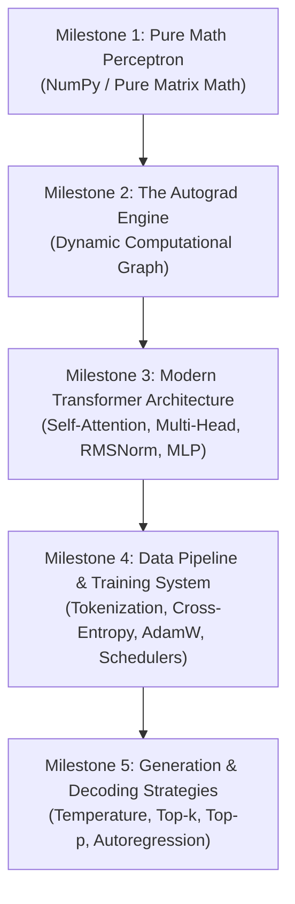
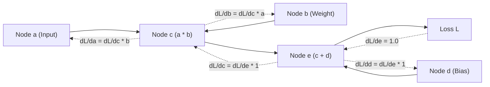
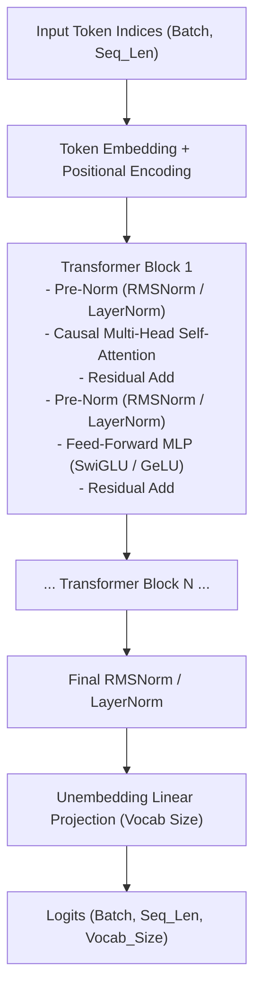
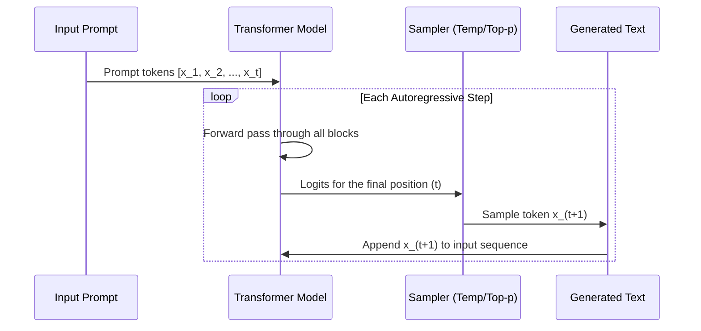

# The Zero-to-One AI Architect's Handbook
## Building an AI Model From Scratch (Self-Coded Roadmap)

---

### Welcome, Architect
You have chosen the purest and most rewarding path to mastering Artificial Intelligence: **writing every single line of code yourself**. 

By building an AI model from first principles—without relying on pre-packaged abstractions or copy-pasting black-box templates—you will master the underlying mathematics, tensor mechanics, memory layouts, computational graphs, and training dynamics that power modern intelligence engines.

As your mentor and technical advisor:
- **No code will be provided by the mentor.** Every function, class, tensor operation, and training loop will be authored by your own hands.
- **The mentor provides the blueprints, the math, the architectural intuition, and real-time debugging assistance.** When you encounter dimension mismatches, exploding gradients, or confusing tensor shapes, the mentor will analyze your logic, explain the root cause, and guide you to your own solution.

---

## 1. The 5-Milestone Journey

Building an AI from scratch is best structured in progressive milestones. Attempting to build a Large Language Model immediately without understanding matrix derivatives or computational graphs often leads to frustration. 

---

## Milestone 1: The Pure Math Perceptron (The Fundamentals of Learning)

Before using automatic differentiation or deep learning frameworks, you must implement forward propagation and backward propagation using only raw matrix multiplication and calculus.

### 1. The Core Mental Model
A neural network is a parameterized function approximator:
$$\hat{y} = f(X; W, b)$$

Training is the process of adjusting parameters $W$ (weights) and $b$ (biases) to minimize a scalar loss function $\mathcal{L}(\hat{y}, y)$.

### 2. The Forward Pass Formulation
For an input vector $x$ (or batch matrix $X$):
1. **Affine Transformation**:
   $$Z^{[1]} = X W^{[1]} + b^{[1]}$$
   - Where $X$ has shape $(B, D_{in})$, $W^{[1]}$ has shape $(D_{in}, D_{hidden})$, and $b^{[1]}$ has shape $(1, D_{hidden})$.
   - $B$ represents the batch size.
2. **Non-Linear Activation**:
   $$A^{[1]} = \sigma(Z^{[1]})$$
   - Without non-linearities, any stack of linear layers collapses into a single matrix: $W_2(W_1 X) = (W_2 W_1)X = W_{eff}X$. Non-linearities (such as ReLU or Sigmoid) allow the network to model arbitrary function boundaries.
   - For ReLU: $\sigma(z) = \max(0, z)$.
3. **Output Layer**:
   $$Z^{[2]} = A^{[1]} W^{[2]} + b^{[2]}$$
   $$\hat{y} = \text{softmax}(Z^{[2]})$$

### 3. The Loss Function: Categorical Cross-Entropy
For a classification task over $C$ classes:
$$\mathcal{L} = -\frac{1}{B} \sum_{i=1}^{B} \sum_{k=1}^{C} y_{i, k} \log(\hat{y}_{i, k})$$

### 4. The Backward Pass (Matrix Calculus & The Chain Rule)
To update the weights, you must compute the gradient of the loss with respect to every parameter: $\frac{\partial \mathcal{L}}{\partial W^{[2]}}$, $\frac{\partial \mathcal{L}}{\partial b^{[2]}}$, $\frac{\partial \mathcal{L}}{\partial W^{[1]}}$, $\frac{\partial \mathcal{L}}{\partial b^{[1]}}$.

- **Gradient of Softmax with Cross-Entropy** (an elegant mathematical simplification):
  $$\delta^{[2]} = \frac{\partial \mathcal{L}}{\partial Z^{[2]}} = \frac{1}{B} (\hat{y} - y)$$
- **Output Layer Gradients**:
  $$\frac{\partial \mathcal{L}}{\partial W^{[2]}} = (A^{[1]})^T \delta^{[2]}$$
  $$\frac{\partial \mathcal{L}}{\partial b^{[2]}} = \sum_{row} \delta^{[2]}$$
- **Backpropagating to Hidden Layer**:
  $$\delta^{[1]} = (\delta^{[2]} (W^{[2]})^T) \odot \sigma'(Z^{[1]})$$
  - Where $\odot$ denotes element-wise (Hadamard) product.
  - For ReLU: $\sigma'(z) = 1 \text{ if } z > 0 \text{ else } 0$.
- **Hidden Layer Gradients**:
  $$\frac{\partial \mathcal{L}}{\partial W^{[1]}} = X^T \delta^{[1]}$$
  $$\frac{\partial \mathcal{L}}{\partial b^{[1]}} = \sum_{row} \delta^{[1]}$$

### 5. Gradient Descent Step
$$W \leftarrow W - \eta \frac{\partial \mathcal{L}}{\partial W}$$
Where $\eta$ is the learning rate.

> [!TIP]
> **Milestone 1 Verification Test**:
> Implement **Numerical Gradient Checking** (finite differences). Approximate the gradient by:
> $$\frac{\partial \mathcal{L}}{\partial W_{i,j}} \approx \frac{\mathcal{L}(W_{i,j} + \epsilon) - \mathcal{L}(W_{i,j} - \epsilon)}{2\epsilon}$$
> If your analytical backpropagation gradient and the finite-difference approximation match to within a relative error of $10^{-7}$, your mathematical derivation is proven correct.

---

## Milestone 2: The Automatic Differentiation Engine (Autograd)

Manually calculating partial derivatives for complex architectures like Transformers is infeasible. Milestone 2 is to build an engine that tracks operations dynamically and computes gradients automatically via a computational graph.

### 1. Conceptual Design of an Autograd Value / Tensor Node
Every node in the computational graph must track:
- **`data`**: The scalar value or multi-dimensional array storing the forward result.
- **`grad`**: The accumulated partial derivative of the final output with respect to this node ($\frac{\partial \mathcal{L}_{final}}{\partial \text{node}}$), initialized to 0.
- **`_prev`**: Pointers to the parent nodes that created this value.
- **`_op`**: The operation that produced it ($+$, $\times$, $\text{pow}$, $\text{relu}$, $\text{matmul}$).
- **`_backward`**: A function closure that computes the local derivative and propagates gradients to parent nodes via the chain rule.

### 2. The Directed Acyclic Graph (DAG) and Topological Sorting
When $\text{backward}()$ is called on the final scalar loss node:
1. The engine constructs a topologically ordered list of all nodes in the graph starting from the loss node back to the root leaves.
2. The loss node's own gradient is initialized to $1.0$ ($\frac{\partial \mathcal{L}}{\partial \mathcal{L}} = 1.0$).
3. The engine traverses the topologically sorted list in reverse order, calling each node's `_backward()` closure.

### 3. Gradient Accumulation Rule
If a node is reused across multiple paths in the graph (e.g. $z = x + x$ or $z = x \cdot y + x$), its gradient must **accumulate** using addition ($+$=), not overwrite:
$$\frac{\partial \mathcal{L}}{\partial x} = \sum_{p \in \text{paths}} \frac{\partial \mathcal{L}}{\partial \text{child}_p} \cdot \frac{\partial \text{child}_p}{\partial x}$$

---

## Milestone 3: The Transformer Architecture (Modern LLM Core)

Once you understand tensors and autograd, you will build the state-of-the-art model architecture: the **Decoder-Only Autoregressive Transformer** (found in GPT-4, Claude, Gemini, LLaMA).

### 1. Token & Positional Embeddings
- **Token Embedding Table**: A lookup matrix $E \in \mathbb{R}^{V \times d_{model}}$ where $V$ is vocabulary size and $d_{model}$ is the hidden dimension. It translates an integer ID into a continuous semantic vector.
- **Positional Encoding**: Transformers process all tokens in parallel and have no inherent concept of order. 
  - *Option A*: Learned positional embeddings (matrix of shape $L_{max} \times d_{model}$).
  - *Option B*: Rotary Position Embeddings (RoPE), which rotate query and key vectors in complex 2D planes according to token distance, preserving relative distance across context windows.

### 2. Scaled Dot-Product Attention
Attention allows every token in the sequence to look at and gather information from other tokens.

Given an input matrix $X \in \mathbb{R}^{T \times d_{model}}$:
1. Project $X$ into three distinct representations via weight matrices $W_Q, W_K, W_V \in \mathbb{R}^{d_{model} \times d_k}$:
   $$Q = X W_Q \quad (\text{Queries: what am I looking for?})$$
   $$K = X W_K \quad (\text{Keys: what information do I hold?})$$
   $$V = X W_V \quad (\text{Values: if matched, what information do I give?})$$

2. Compute Raw Attention Scores:
   $$S = Q K^T$$
   - Matrix shape: $(T, d_k) \times (d_k, T) = (T, T)$.
   - Entry $S_{i, j}$ represents how strongly token $i$ attends to token $j$.

3. **Scaling**: Divide by $\sqrt{d_k}$. 
   - *Why?* For high dimensions, dot products grow large in magnitude, pushing the softmax function into regions with near-zero gradients (vanishing gradients).

4. **Causal Masking (Crucial for Generative Language Models)**:
   - When generating text, token $i$ cannot look into the future (tokens $j > i$).
   - Create a mask matrix where entries for $j > i$ are set to $-\infty$.
   - Since $\exp(-\infty) = 0$, applying softmax to these masked positions ensures future tokens receive zero attention probability.

5. **Softmax & Value Aggregation**:
   $$A = \text{softmax}\left(\frac{Q K^T}{\sqrt{d_k}} + \text{Mask}\right)$$
   $$\text{Output} = A V$$
   - Final shape: $(T, T) \times (T, d_v) = (T, d_v)$.

### 3. Multi-Head Attention (MHA)
Rather than computing a single attention map, Multi-Head Attention splits $d_{model}$ into $h$ heads ($d_{head} = d_{model} / h$).
- Each head independently learns different relational aspects (e.g., one head tracks grammar, another tracks pronoun antecedents, another tracks punctuation).
- The outputs from all heads are concatenated and projected through a final output matrix $W_O \in \mathbb{R}^{d_{model} \times d_{model}}$.

### 4. Normalization: LayerNorm vs. RMSNorm
Modern models use **Pre-Normalization** (applying normalization before attention and MLP blocks, rather than after) to ensure stable gradient flow.

**Root Mean Square Normalization (RMSNorm)**:
Used in modern architectures for computational efficiency:
$$\text{RMS}(x) = \sqrt{\frac{1}{d} \sum_{i=1}^d x_i^2 + \epsilon}$$
$$\bar{x}_i = \frac{x_i}{\text{RMS}(x)} \cdot \gamma_i$$
Where $\gamma$ is a learned scaling vector.

### 5. Feed-Forward Network (FFN / MLP)
After communication between tokens (via attention), each token processes its gathered information individually:
$$\text{FFN}(x) = \sigma(x W_1 + b_1) W_2 + b_2$$
- $W_1$ expands the dimension from $d_{model}$ to $4 \times d_{model}$.
- Non-linearity: Modern models use **SwiGLU** (Swish-Gated Linear Unit) or **GELU** (Gaussian Error Linear Unit).
- $W_2$ contracts the dimension back to $d_{model}$.

### 6. Residual Connections
Every major sub-block uses a skip connection:
$$x \leftarrow x + \text{SubLayer}(\text{Norm}(x))$$
This creates a "gradient highway" enabling signals to flow unimpeded directly through dozens of layers during backpropagation.

---

## Milestone 4: The Training Pipeline & Optimization Engine

### 1. Tokenization from Scratch
A model cannot read raw strings; it processes integer token IDs.
- **Level 1 (Simplest)**: Character-level tokenizer. Map unique characters to integers $0 \dots (V-1)$. Great for debugging and seeing words emerge from raw letters.
- **Level 2 (Production standard)**: Byte-Pair Encoding (BPE). Iteratively replaces the most frequently occurring byte pairs with a new token ID.

### 2. Dataset Slicing (Context Window Batching)
Given a long continuous stream of token IDs:
- Slice into sequences of length $T$ (context window).
- For an input sequence $x = [t_0, t_1, t_2, \dots, t_{T-1}]$, the target sequence is shifted by exactly one position:
  $$y = [t_1, t_2, t_3, \dots, t_T]$$
- At every index $k$, the network learns to predict token $t_{k+1}$ given context $t_0 \dots t_k$.

### 3. The AdamW Optimizer
Standard SGD struggles with sparse gradients and varied parameter scales. AdamW tracks:
- **First moment (mean of gradients)**: $m_t = \beta_1 m_{t-1} + (1 - \beta_1) g_t$
- **Second moment (uncentered variance)**: $v_t = \beta_2 v_{t-1} + (1 - \beta_2) g_t^2$
- **Bias corrections**: $\hat{m}_t = \frac{m_t}{1 - \beta_1^t}, \quad \hat{v}_t = \frac{v_t}{1 - \beta_2^t}$
- **Decoupled Weight Decay**: $W \leftarrow W - \eta \lambda W$
- **Parameter update**: $W \leftarrow W - \frac{\eta}{\sqrt{\hat{v}_t} + \epsilon} \hat{m}_t$

### 4. Learning Rate Schedule: Warmup + Cosine Decay
- **Linear Warmup**: Start with $\eta \approx 0$ and ramp up linearly over the first $N$ steps to avoid destabilizing randomly initialized weights.
- **Cosine Decay**: Gradually decay $\eta$ following a half-cosine curve down to $0.1 \times \eta_{max}$.

---

## Milestone 5: Inference & Generation Mechanics

Once the model predicts logits over the vocabulary, generating text is an autoregressive loop:

### Sampling Strategies
Given output logits vector $z \in \mathbb{R}^V$:
1. **Temperature Scaling**:
   $$p_i = \frac{\exp(z_i / T)}{\sum_j \exp(z_j / T)}$$
   - $T < 1.0$: Sharpens distribution (more deterministic, focused).
   - $T > 1.0$: Flattens distribution (more creative, higher variance).
2. **Top-$k$ Filtering**: Retain only the $k$ highest logit values; set all other logits to $-\infty$ before computing softmax.
3. **Top-$p$ (Nucleus) Filtering**: Sort probabilities in descending order, find the smallest subset whose cumulative probability exceeds $p$ (e.g. $0.90$), and mask out all others.

---

## Curated Deep Learning Resources

### Foundational Textbooks & Theoretical References
1. **"Deep Learning"** by Ian Goodfellow, Yoshua Bengio, and Aaron Courville (*The MIT Press*).
   - *Key Focus*: Linear algebra review, numerical computation, backpropagation calculus, and optimization algorithms.
2. **"Speech and Language Processing" (3rd ed. draft)** by Dan Jurafsky and James H. Martin.
   - *Key Focus*: Chapters on N-gram models, vector semantics, Transformers, and Language Models.
3. **"Mathematics for Machine Learning"** by Marc Peter Deisenroth, A. Aldo Faisal, and Cheng Soon Ong.
   - *Key Focus*: Matrix decompositions, vector calculus, matrix gradients.

### Canonical Research Papers (Read in this sequence)
1. **Attention Is All You Need** (Vaswani et al., 2017)
   - Introduces the original Transformer, Scaled Dot-Product Attention, and Multi-Head Attention.
2. **Language Models are Unsupervised Multitask Learners** (Radford et al., 2019 - GPT-2)
   - Details the decoder-only architecture, pre-normalization placement, and causal language modeling.
3. **RoFormer: Enhanced Transformer with Rotary Position Embedding** (Su et al., 2021)
   - Mathematical derivation of relative positional encodings via 2D rotation matrices.
4. **LLaMA: Open and Efficient Foundation Language Models** (Touvron et al., 2023)
   - The modern blueprint: RMSNorm, SwiGLU activation, RoPE, AdamW hyperparameters.

### Visual & Interactive Exploration
- **3Blue1Brown - Neural Networks & Transformers Playlist**: Unmatched geometric visualization of gradient descent, backpropagation, and self-attention.
- **Jay Alammar - The Illustrated Transformer**: Visual breakdowns of tensor flows through attention heads and feed-forward blocks.
- **bjoernave - Transformer Explainer**: Interactive browser visualization of real-time attention weights and matrix projections.

---

## Recommended Hardware & Workspace Setup

1. **Python Environment**: Use Python 3.10+ in a dedicated virtual environment (`venv` or `conda`).
2. **Framework Choice**:
   - For Milestone 1: Pure **NumPy** to build muscle memory on tensor shapes and gradient derivations.
   - For Milestones 2–5: **PyTorch** (as an underlying tensor computation library with CUDA support), but **without using `torch.nn` modules or high-level abstractions**. You will write your own custom Attention, Normalization, MLP, and Transformer blocks as pure classes using raw tensor operations.
3. **Compute**:
   - Local: An NVIDIA GPU with CUDA support (e.g. RTX 3060/4060 or higher).
   - Cloud (Free): **Google Colab** or **Kaggle Notebooks** provide free access to NVIDIA T4 / P100 GPUs with no setup overhead.

---

## Rules of Engagement (How We Will Pair Program)

To respect your requirement that **you write all code**:
1. **You initiate each step**: Pick a milestone from the roadmap (starting with Milestone 1).
2. **The mentor supplies the design specification**: The inputs, the mathematical transforms, the expected tensor dimensions at every step, and edge cases to watch for.
3. **You write the implementation in your local workspace**: You test it and observe the output.
4. **When you hit a bug or blocker**:
   - Paste the error traceback, the unexpected behavior, or the confusing tensor shapes.
   - The mentor will diagnose the underlying conceptual flaw, point out which dimension or mathematical law was violated, and explain how to reason through the fix without writing the code for you.
5. **Milestone Review**: Once your component runs, we will run sanity tests (like gradient checking or loss convergence checks) before moving to the next layer.
